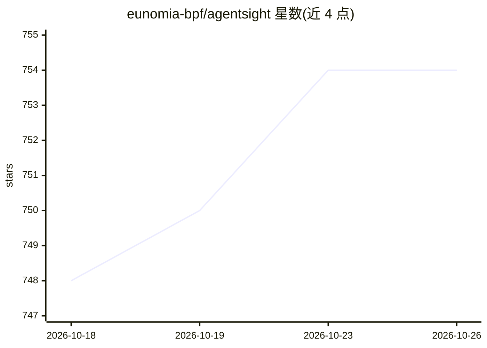

# eunomia-bpf/agentsight

⭐ 754 · C · MIT · 推送 2026-10-23 · [GitHub](https://github.com/eunomia-bpf/agentsight) · [官网](https://eunomia.dev/agentsight/) · 组织维护 · 中文 README

**面向开发者的 eBPF 系统级 AI agent 监控剖析工具**

AgentSight 是本地优先的 top/strace 式 AI agent 观测工具，用 eBPF 与 TLS 流量追踪，将 prompt、模型调用与工具决策关联到进程执行、文件访问与网络活动等系统层效果。无需 SDK、代理或厂商集成即可观测 Claude Code、Codex、Gemini CLI、Cursor 等闭源 CLI agent。提供 top 实时视图、record 会话录制（SQLite 存储）、语义火焰图、Web 界面与 OpenTelemetry GenAI span 导出。完整 eBPF 功能需 Linux 内核 4.1+ 与 root 权限；top/bind/vis/report 可在 Windows/macOS 上使用 agent 会话文件。以 Rust CLI 与库形式发布，评估称典型负载 CPU 开销低于 3%。

## 筛选速览

| 维度 | 判定 | 备注 |
|---|---|---|
| AI 角色 | `ai-ecosystem` | LLM/agent 周边工具 |
| 许可风险 | `permissive` | MIT |
| 部署形态 | `library` | 以包/库形式分发 |
| 模型依赖 | — | README 未给出锁定关系 |
| 硬件要求 | — | 无带数字的原话,不猜 |
| 安装摩擦 | `medium` | 含编译或系统依赖之一 |
| 成熟度 | — | 结构信号不足 |

## 能力要点

- eBPF + TLS 追踪，零 SDK 观测任意 CLI agent 的进程/文件/网络活动
- 跨边界关联 LLM 流量与进程执行、文件事件
- 提供 top 实时视图、SQLite 会话录制、语义火焰图与 Web 界面
- 可导出 OpenTelemetry GenAI span（OTLP/HTTP）

## 适用场景

- 排查 agent 运行失败或卡顿时日志未覆盖的系统层行为
- 审计 agent 的数据外发、文件改动等安全敏感操作
- 分析 agent 会话的 token 消耗与耗时瓶颈

## 场景标签

`LLM 可观测性` · 领域:评测与运维

## 证据(README 行号)

> L12: AgentSight is a local-first `top`/`strace`-like observability tool for AI agents. It connects prompts, model calls,
> L53: AgentSight focuses on the layer those tools often miss: what the agent actually does at the system boundary. It obs
> L210: > **Privileges:** eBPF probes need root. Use `sudo` for live capture commands.

## 星数曲线

2026-10-18 748 → 2026-10-26 754（+6）

---
*卡片 v1 · prompt 1.4 · 生成 2026-10-22 · 置信度 high · 依据 README sha `83eeacdfcb55` · [字段定义](../../DATASET.md)*
