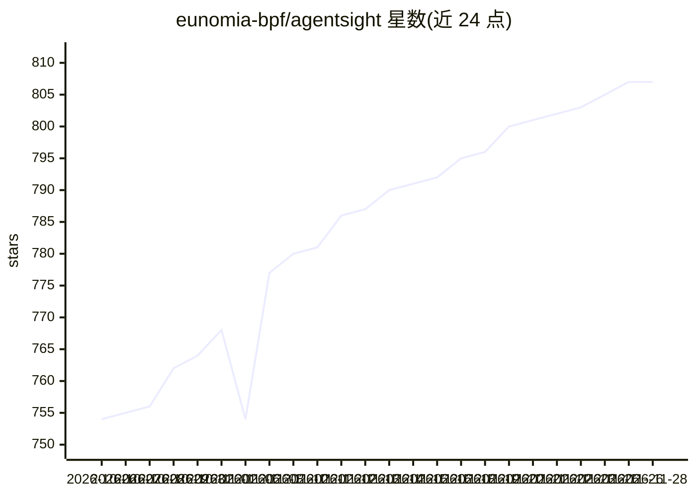

# eunomia-bpf/agentsight

⭐ 807 · C · MIT · 推送 2026-11-27 · [GitHub](https://github.com/eunomia-bpf/agentsight) · [官网](https://eunomia.dev/agentsight/) · 组织维护

**面向 AI Agent 的本地系统级可观测性工具**

AgentSight 是一款本地优先的类 top/strace 观测工具，用 eBPF 与 TLS 流量追踪观察 AI Agent 在系统边界的实际行为：监控活跃会话、进程、模型与工具调用、文件与网络活动，将 prompt 与错误关联，统计时间、token 与资源去向，并支持安全审计。无需 SDK、代理或厂商集成，可观察闭源 CLI Agent。数据存为 SQLite，可经 OpenTelemetry 导出，提供 Web 界面查看时间线、进程树与指标。

## 筛选速览

| 维度 | 判定 | 备注 |
|---|---|---|
| AI 角色 | `ai-ecosystem` | LLM/agent 周边工具 |
| 许可风险 | `permissive` | MIT |
| 部署形态 | `desktop` | 安装包/桌面程序 |
| 模型依赖 | — | README 未给出锁定关系 |
| 硬件要求 | — | 无带数字的原话,不猜 |
| 安装摩擦 | `medium` | 含编译或系统依赖之一 |
| 成熟度 | — | 结构信号不足 |

## 能力要点

- 基于 eBPF 与 TLS 追踪，无需 SDK/proxy 即可观察闭源 CLI Agent
- 将 LLM 流量与进程执行、文件访问、系统活动跨边界关联
- 会话存为 SQLite，支持 report 结构化查询与 OpenTelemetry GenAI 导出
- 提供 Web 界面（时间线/进程树/事件日志/指标）与语义火焰图

## 适用场景

- 排查 Agent 运行失败、卡顿或行为异常的真实系统原因
- 分析开发会话中 token 与资源的消耗去向
- 审计 Agent 访问了哪些服务、改动了哪些文件
- 为现有 Claude Code/Codex 等 CLI 会话生成回放与成本火焰图

## 场景标签

`LLM 可观测性` · 领域:评测与运维

## 证据(README 行号)

> L12: AgentSight is a local-first `top`/`strace`-like observability tool for AI agents. It connects prompts, model calls,
> L18: - **Use it with your existing agents.** Run AgentSight around Claude Code, Codex, Gemini CLI, OpenCode, OpenClaw, o
> L53: AgentSight focuses on the layer those tools often miss: what the agent actually does at the system boundary. It obs

## 星数曲线

2026-10-26 754 → 2026-11-28 807（+53）

---
*卡片 v1 · prompt 1.4 · 生成 2026-11-27 · 置信度 high · 依据 README sha `62ab24fab47b` · [字段定义](../../DATASET.md)*
