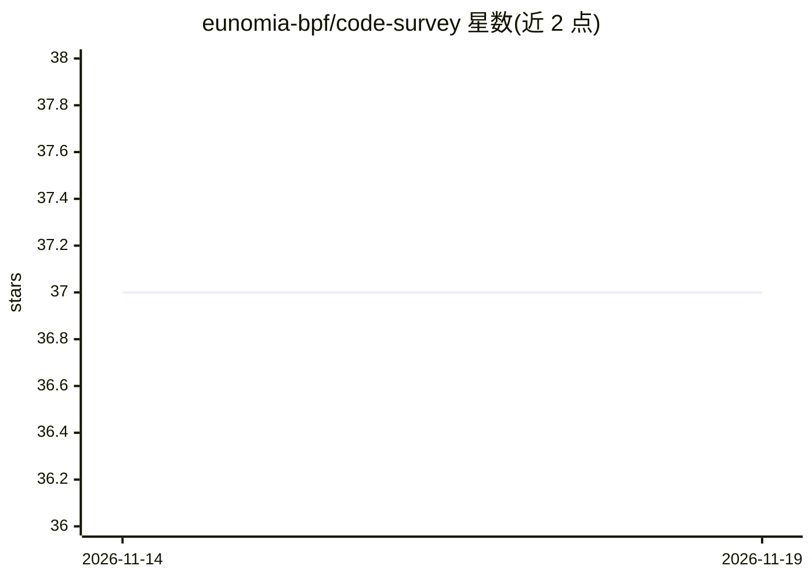

# eunomia-bpf/code-survey

⭐ 37 · Python · 推送 2026-11-15 · [GitHub](https://github.com/eunomia-bpf/code-survey) · 组织维护

**用 LLM 问卷调查大规模代码库（如 Linux 内核）演化洞察**

将 LLM 视作问卷调查参与者的代码库分析方法：由人类专家或 LLM Agent 设计调查问卷，对 git commit、邮件等非结构化数据逐条作答打标，转化为结构化数据后做统计分析并生成报告，聚焦设计、维护、可靠性等软件演化问题。附带 Linux eBPF 子系统数据集（680+ 专家标注 commit、12000+ BPF commit、150000+ 邮件摘要 TODO）。脚本依赖 OPENAI_API_KEY 运行；项目自述为原型、进行中，LLM 可能出错，需专家监督设计问卷与解读结果。

## 筛选速览

| 维度 | 判定 | 备注 |
|---|---|---|
| AI 角色 | `ai-native` | 本体是模型或模型工具 |
| 许可风险 | `none` | — |
| 部署形态 | `None` |  |
| 模型依赖 | — | README 未给出锁定关系 |
| 硬件要求 | — | 无带数字的原话,不猜 |
| 安装摩擦 | `low` | 无编译、无系统依赖或容器化 |
| 成熟度 | `idea` | |

## 能力要点

- LLM Agent 逐条回答问卷，把 commit/邮件转为结构化数据
- 三步工作流：设计问卷→LLM 作答→分析结果与生成报告
- 提供 Linux eBPF 子系统数据集（680+ 专家标注、12000+ commit）
- 含 survey YAML 示例与两个运行脚本（survey_agent.py / survey_struct.py）

## 适用场景

- 分析 Linux 内核等大规模代码库的组件演化与 bug 分布
- 对海量 commit 和邮件做结构化标注后定量分析
- 研究生或内核开发者研究子系统设计决策的演变

## 场景标签

`科研工具` · 领域:学习与行业

## 证据(README 行号)

> L6: **Code-Survey** is the first step in using LLMs to gain meaningful insights into large-scale software systems. Unlik
> L56: 2. **LLM Agents complete the surveys**: Answering yes/no, tagging relevant data, and summarizing key information. *

## 星数曲线

2026-11-14 37 → 2026-11-19 37（+0）

---
*卡片 v1 · prompt 1.4 · 生成 2026-11-18 · 置信度 high · 依据 README sha `986dc231ac4a` · [字段定义](../../DATASET.md)*
