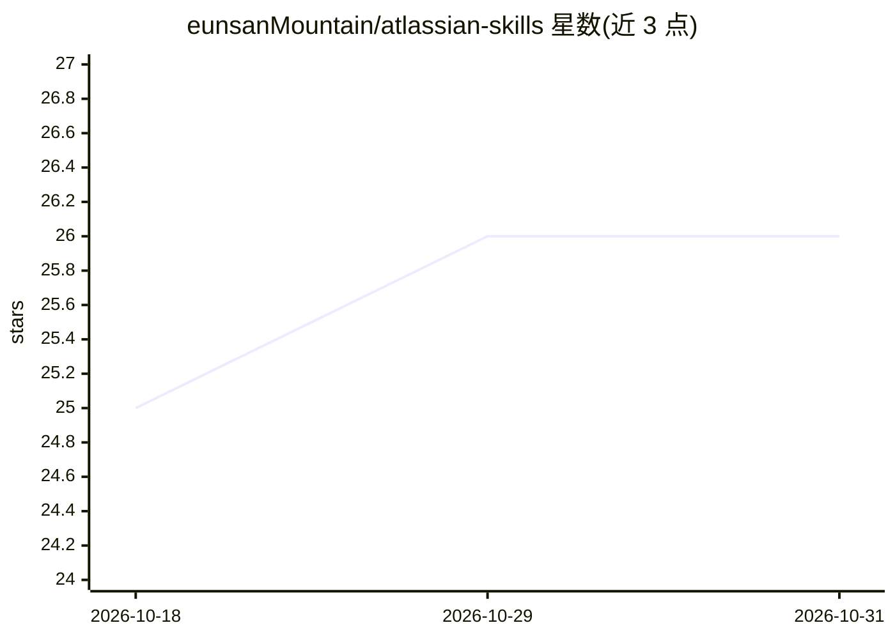

# eunsanMountain/atlassian-skills

⭐ 26 · Python · MIT · 推送 2026-10-20 · [GitHub](https://github.com/eunsanMountain/atlassian-skills) · [官网](https://pypi.org/project/atlassian-skills/) · 个人维护

**面向 LLM agent 的 Atlassian Server/DC 轻量命令行客户端**

Python 实现的 CLI（命令 atls），对 Jira、Confluence、Bitbucket Server 执行操作并以紧凑输出降低 token 消耗，自称 mcp-atlassian 在 Server/DC 场景下的替代。Confluence 流程使用可移植 Markdown 与源绑定 cfxmark 证明，Jira 描述字段按字节保留。提供 atls setup 交互式向导，一次配置 URL、令牌（OS keyring 存储）并为 Claude Code、Codex、GitHub Copilot 安装 agent 技能；支持环境变量、keyring、1Password/pass/Bitwarden 命令等凭据来源与多 profile。

## 筛选速览

| 维度 | 判定 | 备注 |
|---|---|---|
| AI 角色 | `ai-ecosystem` | LLM/agent 周边工具 |
| 许可风险 | `permissive` | MIT |
| 部署形态 | `library` | 以包/库形式分发 |
| 模型依赖 | — | README 未给出锁定关系 |
| 硬件要求 | — | 无带数字的原话,不猜 |
| 安装摩擦 | `low` | 无编译、无系统依赖或容器化 |
| 成熟度 | — | 结构信号不足 |

## 能力要点

- 紧凑输出，端到端 token 消耗对比 MCP 基线降低 91%（自称）
- 一次 atls setup 向导同时配置 Claude Code + Codex + GitHub Copilot 技能
- 凭据仅写入 OS keyring，向导拒绝非 TTY 输入防令牌泄入 LLM 上下文
- 支持 keyring / 环境变量 / shell 命令（1Password、pass、Bitwarden）三类令牌来源

## 适用场景

- 让 Claude Code / Codex / Copilot agent 在 Server/DC 环境操作 Jira 与 Confluence
- token 预算紧张时替代 MCP 方式访问 Atlassian
- 用 CI 或 headless 环境变量方式管理多套 Atlassian 凭据

## 场景标签

 · 领域:开发者工具/LLM agent 集成

## 证据(README 行号)

> L10: A token-efficient CLI that brings mcp-atlassian functionality to the command line — optimized for LLM agent workflo
> L16: First-class integration with **Claude Code**, **Codex**, and **GitHub Copilot**. A single `atls setup` wizard confi

## 星数曲线

2026-10-18 25 → 2026-10-31 26（+1）

---
*卡片 v1 · prompt 1.4 · 生成 2026-10-27 · 置信度 high · 依据 README sha `8bdfef6c8bbb` · [字段定义](../../DATASET.md)*
