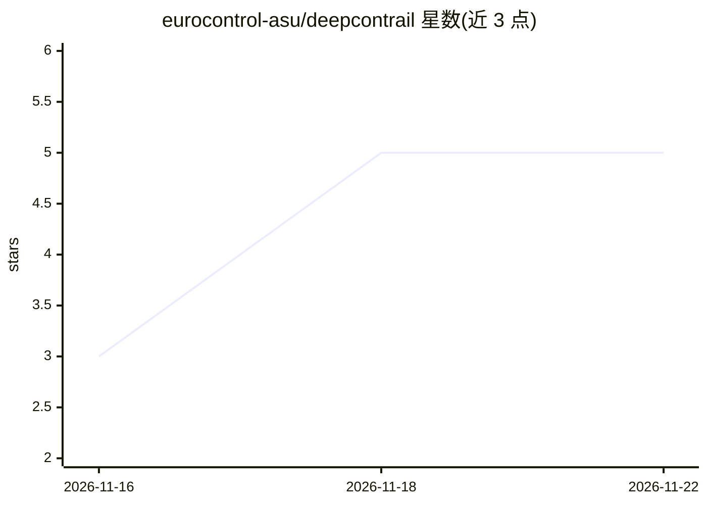

# eurocontrol-asu/deepcontrail

⭐ 5 · Python · EUPL-1.2 · 推送 2026-11-20 · [GitHub](https://github.com/eurocontrol-asu/deepcontrail) · [官网](https://huggingface.co/eurocontrol-asu/deepcontrail-segmentation) · 组织维护

**对开发者提供 GOES-16 卫星影像中的凝结尾迹检测分割库**

开源 Python 库（uv workspace 多包结构），对 GOES-16 ABI 影像做凝结尾迹的语义分割与实例分割，基于 OpenContrails 数据集训练与评估；跟踪、航班归因与高度估计列在路线图尚未发布。语义分割参考模型为 Unet++ + CAFormer-B36 编码器，权重发布在 Hugging Face Hub；实例分割包不含 torch。当前为 alpha 状态，API 可能变更；支持 Python 3.11–3.13，测试环境为 Linux。开发过程使用了 Claude Code 辅助编写代码、测试与文档。

## 筛选速览

| 维度 | 判定 | 备注 |
|---|---|---|
| AI 角色 | `ai-native` | 本体是模型或模型工具 |
| 许可风险 | `viral` | EUPL-1.2 |
| 部署形态 | `library` | 以包/库形式分发 |
| 模型依赖 | — | README 未给出锁定关系 |
| 硬件要求 | — | 无带数字的原话,不猜 |
| 安装摩擦 | `low` | 无编译、无系统依赖或容器化 |
| 成熟度 | `idea` | |

## 能力要点

- 语义分割模型（Unet++ + CAFormer-B36）预训练权重发布于 Hugging Face Hub
- 实例分割将概率图拆分为单个尾迹并输出 COCO 结果格式
- 包级拆分：core 无 torch 依赖，segmentation 含训练与预测接口
- 提供 OpenContrails TFRecords 转换器与数据格式校验工具

## 适用场景

- 对 GOES-16 卫星影像批量检测凝结尾迹像素
- 将分割结果拆分为单个尾迹并输出 COCO 格式检测结果
- 在 OpenContrails 数据集上训练自己的分割模型
- 将其他传感器数据转换为 DeepContrail 数据集格式后运行预测

## 场景标签

`目标检测` `模型训练` · 领域:感知与多模态

## 证据(README 行号)

> L9: Open-source library for **contrail detection in satellite imagery**. It does semantic and
> L25: 1. **Semantic segmentation**: detect contrail pixels in GOES-16 imagery (**released in v0.1.0**)
> L40: |`deepcontrail-segmentation`|`deepcontrail.segmentation`|Semantic segmentation: dataset, models, losses, training (

## 星数曲线

2026-11-16 3 → 2026-11-22 5（+2）

---
*卡片 v1 · prompt 1.4 · 生成 2026-11-21 · 置信度 high · 依据 README sha `2658494b15f3` · [字段定义](../../DATASET.md)*
