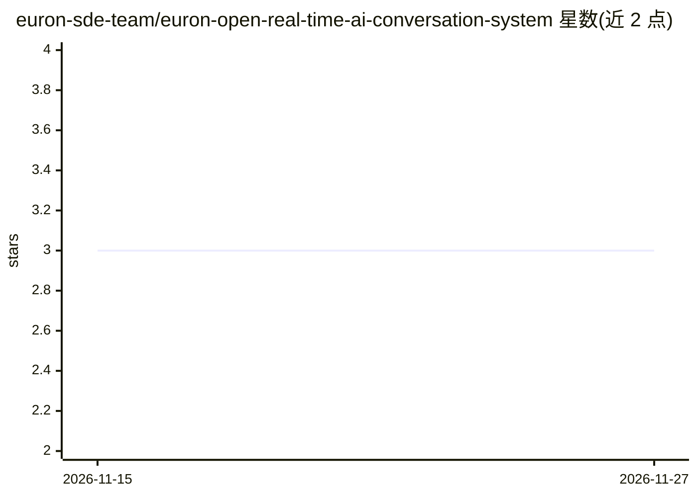

# euron-sde-team/euron-open-real-time-ai-conversation-system

⭐ 3 · TypeScript · MIT · 推送 2026-10-28 · [GitHub](https://github.com/euron-sde-team/euron-open-real-time-ai-conversation-system) · 组织维护

**自托管实时语音 AI 模拟面试系统，含计划、监考与评分报告**

自托管的 AI 模拟面试产品：上传简历（PDF/DOCX）或粘贴职位描述后生成面试计划，由实时语音面试官通过 OpenAI Realtime 或 Gemini Live 提问并追问，支持代码题编辑器、浏览器端监考（摄像头在场与标签页检查）、逐轮评分报告、PDF 导出与可撤销分享链接。服务端锁定面试官指令与模型凭据，服务端计分与计费，简历不落盘；本地可用无 API key 的替身运行，AWS 以 Terraform 部署，附 /admin 管理控制台。

## 筛选速览

| 维度 | 判定 | 备注 |
|---|---|---|
| AI 角色 | `ai-native` | 本体是模型或模型工具 |
| 许可风险 | `permissive` | MIT |
| 部署形态 | `None` |  |
| 模型依赖 | — | README 未给出锁定关系 |
| 硬件要求 | — | 无带数字的原话,不猜 |
| 安装摩擦 | `low` | 无编译、无系统依赖或容器化 |
| 成熟度 | — | 结构信号不足 |

## 能力要点

- 从简历或职位描述生成可编辑的个性化面试计划
- OpenAI Realtime（WebRTC）或 Gemini Live 实时语音面试，支持打断与追问
- 服务端锁定凭据与指令，浏览器不见 provider key；服务端评分与语音时长计量
- 本地无 API key 全流程可跑（替身计划/评分/stub 语音）

## 适用场景

- 求职前用语音模拟面试并拿到逐轮评分反馈
- 练习技术岗的代码题并获得修正代码建议
- 机构自托管面试练习平台并管理用户配额与成本

## 场景标签

`语音 Agent` · 领域:对话与助手

## 证据(README 行号)

> L36: **Euron Open Conversation** is an open-source, self-hosted **AI mock interviewer you talk to**. Upload
> L40: in real time, over **OpenAI Realtime** or **Gemini Live**: it asks each question, listens, asks two
> L124: |**Apps**|Web app (Next.js) with the live room and the `/admin` control plane, API, background worker, and a stubs

## 星数曲线

2026-11-15 3 → 2026-11-27 3（+0）

---
*卡片 v1 · prompt 1.4 · 生成 2026-11-22 · 置信度 high · 依据 README sha `00fd5b0906d4` · [字段定义](../../DATASET.md)*
