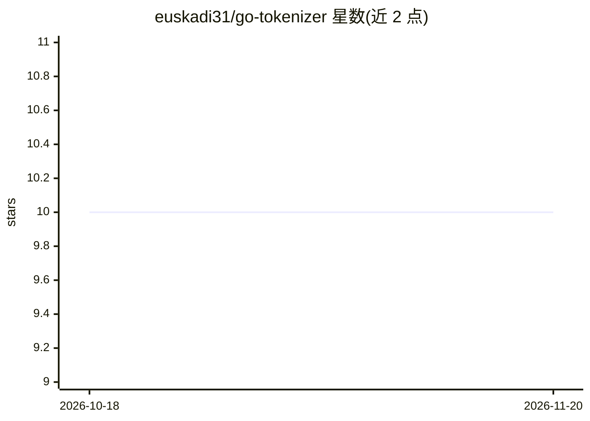

# euskadi31/go-tokenizer

⭐ 10 · Go · MIT · 推送 2026-11-09 · [GitHub](https://github.com/euskadi31/go-tokenizer) · 个人维护

**Go 语言文本分词库，供开发者在 NLP 流程中切分文本**

以 Go 包（模块 v3）形式发布的文本分词（tokenizer）库，通过 go get 安装后在代码中 import 使用，README 含示例代码片段，采用 MIT 许可。README 内容较简短，仅包含安装命令、导入示例与许可证说明，未展开说明分词算法、支持的语种或具体功能细节。面向需要在 Go 项目中做文本处理的开发者。

## 筛选速览

| 维度 | 判定 | 备注 |
|---|---|---|
| AI 角色 | `ai-native` | 本体是模型或模型工具 |
| 许可风险 | `permissive` | MIT |
| 部署形态 | `None` |  |
| 模型依赖 | — | README 未给出锁定关系 |
| 硬件要求 | — | 无带数字的原话,不猜 |
| 安装摩擦 | `low` | 无编译、无系统依赖或容器化 |
| 成熟度 | — | 结构信号不足 |

## 能力要点

- Go 包形式发布，支持 go get 安装（v3 模块路径）
- MIT 许可证
- README 提供导入与使用示例代码

## 适用场景

- 在 Go 项目中对文本做分词处理
- 构建 NLP/机器学习相关的 Go 服务时处理文本

## 场景标签

 · 领域:自然语言处理/开发库

## 证据(README 行号)

> L1: # Text Tokenizer for Golang Last release
> L21: go-tokenizer is licensed under the MIT license.

## 星数曲线

2026-10-18 10 → 2026-11-20 10（+0）

---
*卡片 v1 · prompt 1.4 · 生成 2026-11-19 · 置信度 mid · 依据 README sha `28ebf402c7bb` · [字段定义](../../DATASET.md)*
