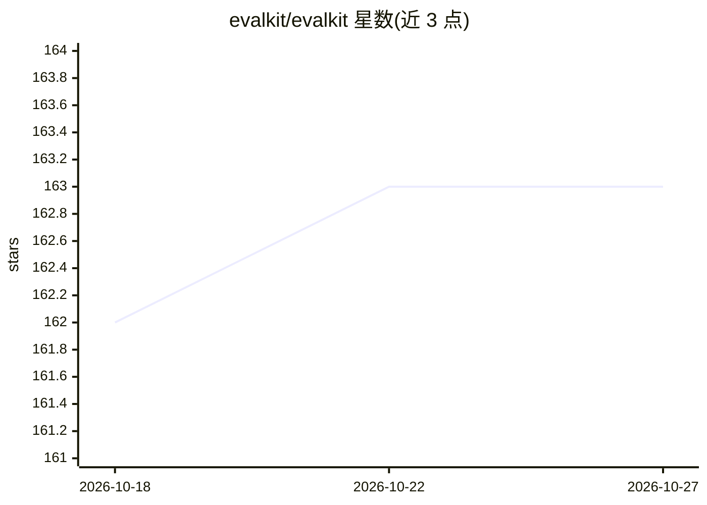

# evalkit/evalkit

⭐ 163 · TypeScript · 推送 2025-11-11 · [GitHub](https://github.com/evalkit/evalkit) · [官网](https://evalkit.ai) · 组织维护

**TypeScript 开发者的 LLM 评测库：多项指标评估模型表现**

开源 TypeScript 库，面向 TypeScript 开发者评估与改进大语言模型表现。核心包 @evalkit/core 提供偏倚检测、连贯性、G-Eval 动态指标、忠实度、幻觉、意图识别、语义相似度等指标及报告功能。运行需 Node.js 18+ 与 OpenAI API Key，通过 npm 安装。文档含教程、用例配方与多 LLM 提供商接入说明，许可证为 Apache 2.0。

## 筛选速览

| 维度 | 判定 | 备注 |
|---|---|---|
| AI 角色 | `ai-ecosystem` | LLM/agent 周边工具 |
| 许可风险 | `none` | — |
| 部署形态 | `library` | 以包/库形式分发 |
| 模型依赖 | — | README 未给出锁定关系 |
| 硬件要求 | — | 无带数字的原话,不猜 |
| 安装摩擦 | `low` | 无编译、无系统依赖或容器化 |
| 成熟度 | — | 结构信号不足 |

## 能力要点

- 提供偏倚检测、忠实度、幻觉、意图识别等评测指标
- 支持 G-Eval 动态指标与语义相似度指标
- 核心包 @evalkit/core 经 npm 安装，含报告功能

## 适用场景

- TypeScript 项目中对 LLM 输出做自动化评测
- 检测模型回答的幻觉与偏倚问题
- 按业务意图评估模型回答的匹配度

## 场景标签

`模型评测` · 领域:评测与运维

## 证据(README 行号)

> L3:  The TypeScript LLM Evaluations Library
> L6:  EvalKit is an open-source library designed for TypeScript developers to evaluate and improve the performance of lar

## 星数曲线

2026-10-18 162 → 2026-10-27 163（+1）

---
*卡片 v1 · prompt 1.4 · 生成 2026-10-22 · 置信度 high · 依据 README sha `2800a74e768d` · [字段定义](../../DATASET.md)*
