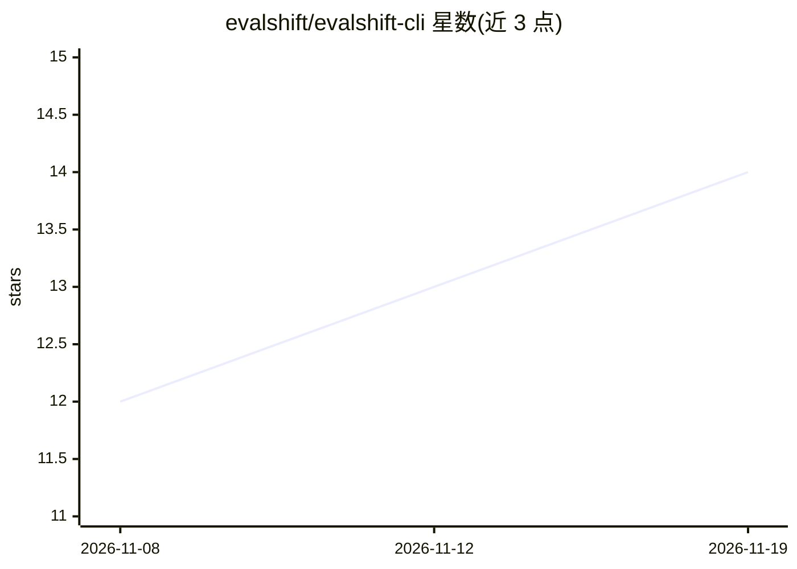

# evalshift/evalshift-cli

⭐ 14 · Python · Apache-2.0 · 推送 2026-11-17 · [GitHub](https://github.com/evalshift/evalshift-cli) · [官网](https://www.evalshift.dev) · 组织维护

**为 AI agent 提供 LLM 迁移与回归测试的 CLI 工具**

由 SDK、CLI、GitHub Action 与可选托管服务四部分组成：SDK 以 stdlib-only 记录生产环境中 agent 的模型调用、工具调用与最终输出为 capture 文件，CLI 将这些 golden suite 在两个模型上重放，用结构/语义/LLM-as-judge/工具调用四类评估器打分，产出含配对检验、Cohen's d、95% CI 与 Benjamini-Hochberg 校正的单文件 HTML 报告。本地运行默认不出机器，托管上传为显式 opt-in。面向维护 LLM agent 并需在模型迁移或 CI 变更时做回归把关的开发团队。

## 筛选速览

| 维度 | 判定 | 备注 |
|---|---|---|
| AI 角色 | `ai-ecosystem` | LLM/agent 周边工具 |
| 许可风险 | `permissive` | Apache-2.0 |
| 部署形态 | `library` | 以包/库形式分发 |
| 模型依赖 | — | README 未给出锁定关系 |
| 硬件要求 | — | 无带数字的原话,不猜 |
| 安装摩擦 | `low` | 无编译、无系统依赖或容器化 |
| 成熟度 | — | 结构信号不足 |

## 能力要点

- capture SDK 从生产运行生成 golden suite，支持手写套件
- 工具调用回归检测：调用选择、参数、顺序与并行度，trace_invariants 契约校验
- 迁移决策带统计检验：配对检验、Cohen's d、95% CI、BH 校正
- GitHub Action 在 PR 上按 suite 矩阵运行并以 migration_policy 门禁合并

## 适用场景

- 把 agent 从一个 LLM 版本迁移到另一个前对比行为差异
- 在 CI 中对每次 PR 运行评估套件并门禁回归
- 从生产流量沉淀 golden suite 而非手写测试集

## 场景标签

`模型评测` · 领域:评测与运维

## 证据(README 行号)

> L14: **The SDK captures what your agent really did. The CLI replays it against a
> L28: scores the outputs with structural / semantic / LLM-as-judge / tool-call
> L51: |**GitHub Action** — `evalshift/evalshift-action@v0`|Runs the pipeline on pull requests, pushes the run, posts one 

## 星数曲线

2026-11-08 12 → 2026-11-19 14（+2）

---
*卡片 v1 · prompt 1.4 · 生成 2026-11-18 · 置信度 high · 依据 README sha `df61d488f42b` · [字段定义](../../DATASET.md)*
