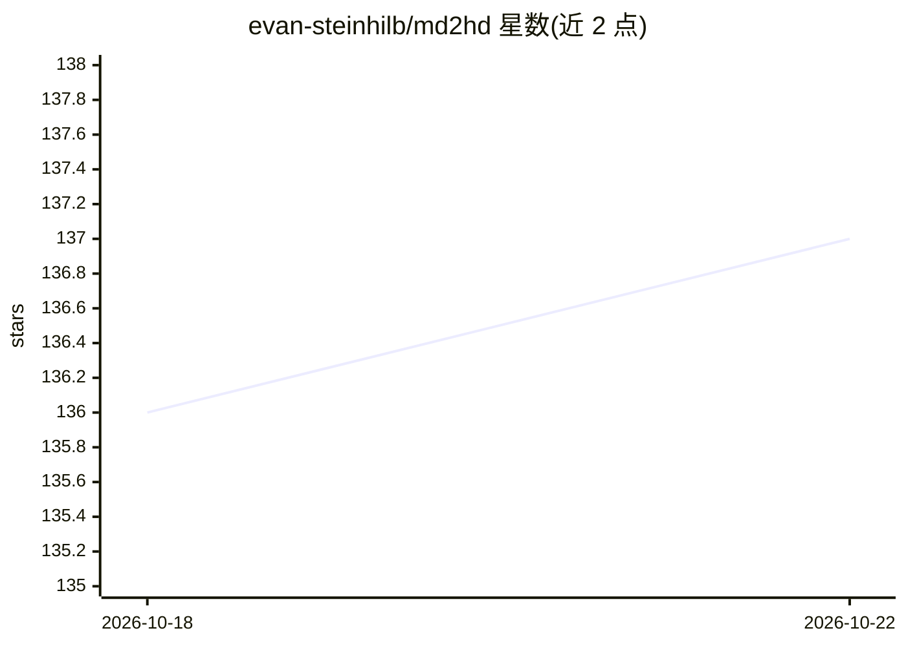

# evan-steinhilb/md2hd

⭐ 137 · JavaScript · MIT · 推送 2026-08-26 · [GitHub](https://github.com/evan-steinhilb/md2hd) · [官网](https://md2hd.com) · 个人维护

**把 Markdown 笔记渲染为可交互关系图的本地 CLI 工具**

Node.js CLI，指向单个 Markdown 文件或文件夹后启动本地服务器（绑定 127.0.0.1），在浏览器中打开关系图：frontmatter 块映射为节点，wikilink 与 rel: 条目映射为边，可选 type: map 块配置颜色与布局。支持节点聚焦视图、按类型浏览、搜索、地图内直接编辑源文件、保存后刷新即重读磁盘。附带一个教编码型 agent 编写 md2hd 地图的技能包，可经 npx skills 或 Claude Code 插件安装。无账户、无遥测，MIT 许可。

## 筛选速览

| 维度 | 判定 | 备注 |
|---|---|---|
| AI 角色 | `ai-enhanced` | 去掉 AI 部分产品仍成立 |
| 许可风险 | `permissive` | MIT |
| 部署形态 | `library` | 以包/库形式分发 |
| 模型依赖 | — | README 未给出锁定关系 |
| 硬件要求 | — | 无带数字的原话,不猜 |
| 安装摩擦 | `low` | 无编译、无系统依赖或容器化 |
| 成熟度 | — | 结构信号不足 |

## 能力要点

- frontmatter→节点、wikilink/rel:→边的 Markdown 映射语法
- 本地服务器绑定 127.0.0.1，无账户无遥测
- 地图内 Code 面板直接编辑源文件并实时重绘
- 附带 teaching agent 编写地图的技能包（writing-md2hd-maps）

## 适用场景

- 把已有的文件夹笔记变成可交互的组织/主题关系图
- 通过聚焦视图查看某节点的上下游连接
- 让编码型 agent 把现有笔记整理成 md2hd 地图

## 场景标签

`知识库管理` · 领域:知识与检索

## 证据(README 行号)

> L3: **Markdown, mapped.** Point it at a file or a folder of notes and it opens a
> L82: Writing a map by hand is easy; having a coding agent write one that

## 星数曲线

2026-10-18 136 → 2026-10-22 137（+1）

---
*卡片 v1 · prompt 1.4 · 生成 2026-10-22 · 置信度 high · 依据 README sha `476cdfc22643` · [字段定义](../../DATASET.md)*
