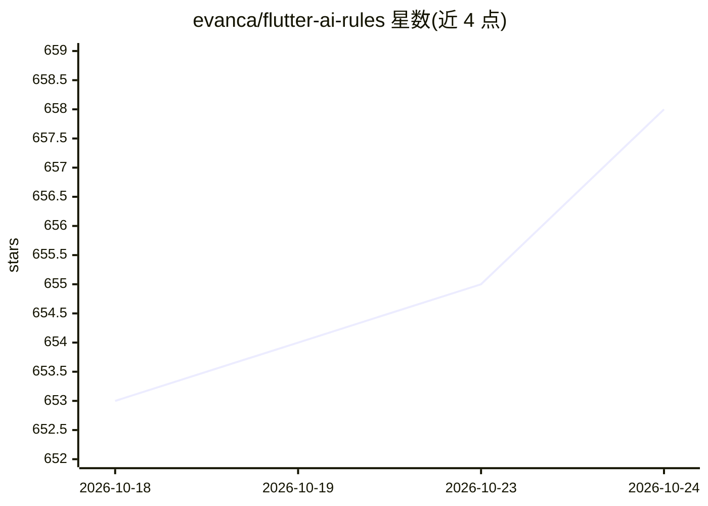

# evanca/flutter-ai-rules

⭐ 660 · Shell · MIT · 推送 2026-10-10 · [GitHub](https://github.com/evanca/flutter-ai-rules) · 个人维护

**36 个源自官方文档的 Flutter/Dart AI 编码技能集，供编码 agent 自主加载**

面向使用 Claude Code、Codex、Cursor、Antigravity、Windsurf 等 AI 编码代理的 Flutter 开发者的技能（SKILL.md）与规则文件合集：36 个技能全部派生自 Flutter、Dart、Firebase 及各包的官方文档，覆盖基础实践、状态管理（Bloc/Riverpod/Provider）、测试、Firebase 全家桶与上架相关主题。agent 读取技能描述后按任务自动加载对应指引；安装途径包括 npx Skills CLI（需 Node 22.20+）、各 agent 的插件市场、git clone 手动拷贝；另提供遗留 rules/ 与 combined/ 静态文件（GitHub Copilot 不支持 SKILL.md，走此路径）。内容按计划从上游文档重新抓取以跟踪官方指南变化；不同技能可能因来源不同而互相矛盾。

## 筛选速览

| 维度 | 判定 | 备注 |
|---|---|---|
| AI 角色 | `ai-knowledge` | 知识聚合/清单类 |
| 许可风险 | `permissive` | MIT |
| 部署形态 | `library` | 以包/库形式分发 |
| 模型依赖 | — | README 未给出锁定关系 |
| 硬件要求 | — | 无带数字的原话,不猜 |
| 安装摩擦 | `low` | 无编译、无系统依赖或容器化 |
| 成熟度 | — | 结构信号不足 |

## 能力要点

- 36 个技能仅源自官方文档，无个人偏好或自创约定
- SKILL.md 按任务上下文自动加载，无需手动粘贴规则
- 支持 Skills CLI、Claude Code/Codex/Cursor/Antigravity 插件市场、手动拷贝等多种安装途径
- 内容按计划从上游官方文档重新抓取更新

## 适用场景

- 让 Claude Code/Codex/Cursor 等编码 agent 在写 Flutter 代码时自动获得官方最佳实践
- 处理 Firebase Auth、Firestore、FCM 等集成任务时获得对应指引
- 在不支持 SKILL.md 的工具（如 GitHub Copilot）中用静态规则文件获得同样指引

## 场景标签

`提示工程` · 领域:Agent 开发

## 证据(README 行号)

> L5: **36 Flutter and Dart skills your coding agent loads by itself, sourced only from official documentation.**
> L7: A skill is a folder with a `SKILL.md` file. Your agent reads the description, decides a task matches, and pulls in t
> L9: A comprehensive, (almost) non-opinionated collection: everything here is derived from official Flutter, Dart, Fireba

## 星数曲线

2026-10-18 653 → 2026-10-24 658（+5）

---
*卡片 v1 · prompt 1.4 · 生成 2026-10-21 · 置信度 high · 依据 README sha `862def51fece` · [字段定义](../../DATASET.md)*
