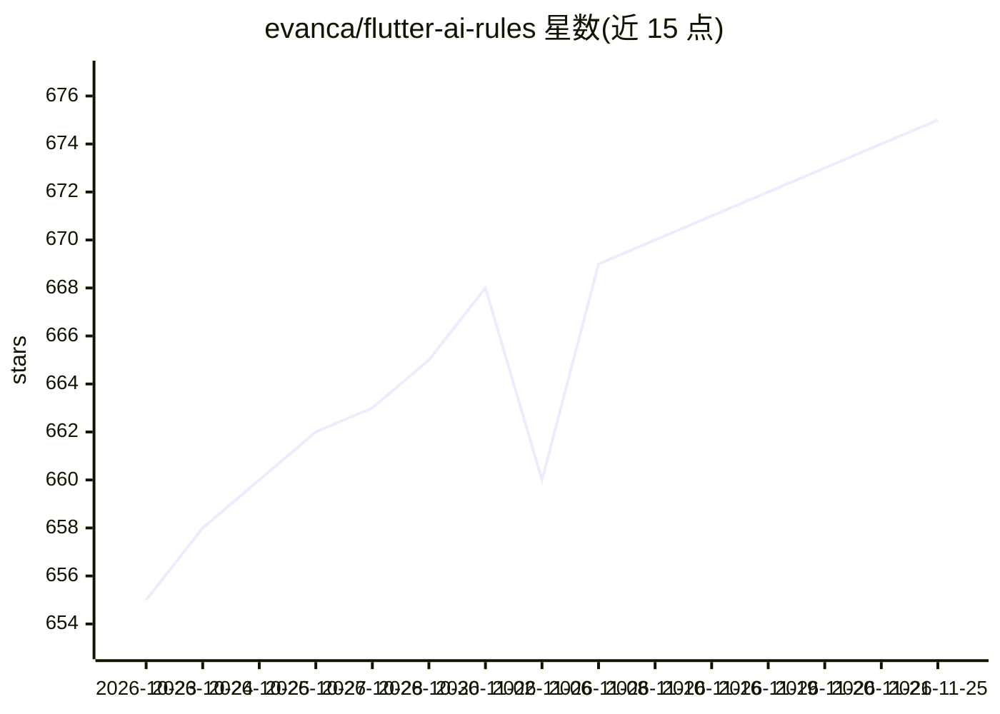

# evanca/flutter-ai-rules

⭐ 675 · Shell · MIT · 推送 2026-11-12 · [GitHub](https://github.com/evanca/flutter-ai-rules) · 个人维护

**Flutter/Dart 开发者的 AI 编程代理技能集（36 条）**

面向使用 Claude Code、Codex、Cursor 等 AI 编程代理的 Flutter 开发者，提供 36 个以 SKILL.md 文件夹形式组织的技能，内容全部取自 Flutter、Dart、Firebase 及各包的官方文档，按基础、状态管理、测试、Firebase、发布等类别划分，代理按任务描述自动加载对应技能。安装方式包括 Skills CLI（需 Node 22.20+）、各代理的插件市场、手动复制到技能目录；另保留旧式 rules 与 combined 规则文件供不支持技能的代理（如 GitHub Copilot）使用。内容按上游文档定期重新抓取更新。

## 筛选速览

| 维度 | 判定 | 备注 |
|---|---|---|
| AI 角色 | `ai-knowledge` | 知识聚合/清单类 |
| 许可风险 | `permissive` | MIT |
| 部署形态 | `library` | 以包/库形式分发 |
| 模型依赖 | — | README 未给出锁定关系 |
| 硬件要求 | — | 无带数字的原话,不猜 |
| 安装摩擦 | `low` | 无编译、无系统依赖或容器化 |
| 成熟度 | — | 结构信号不足 |

## 能力要点

- 36 个技能覆盖 Flutter/Dart 基础、状态管理、测试、Firebase 与发布
- 内容全部来源官方文档并附 ATTRIBUTION 归属，定期从上游文档重新抓取
- 支持 Skills CLI、Claude Code/Codex/Cursor/Antigravity 插件市场与手动复制多种安装方式
- 为不支持 SKILL.md 的代理（GitHub Copilot）提供 rules 与 combined 规则文件替代方案

## 适用场景

- 让 Claude Code/Cursor 等代理写 Flutter 代码时自动加载官方最佳实践
- 写 Bloc/Riverpod 状态管理或 Firebase 集成时获取对应技能指引
- 在不支持技能机制的代理中通过规则文件获得相同指导

## 场景标签

`提示工程` · 领域:Agent 开发

## 证据(README 行号)

> L5: **36 Flutter and Dart skills your coding agent loads by itself, sourced only from official documentation.**
> L7: A skill is a folder with a `SKILL.md` file. Your agent reads the description, decides a task matches, and pulls in t

## 星数曲线

2026-10-23 655 → 2026-11-25 675（+20）

---
*卡片 v1 · prompt 1.4 · 生成 2026-11-24 · 置信度 high · 依据 README sha `7876bd7e2ea2` · [字段定义](../../DATASET.md)*
