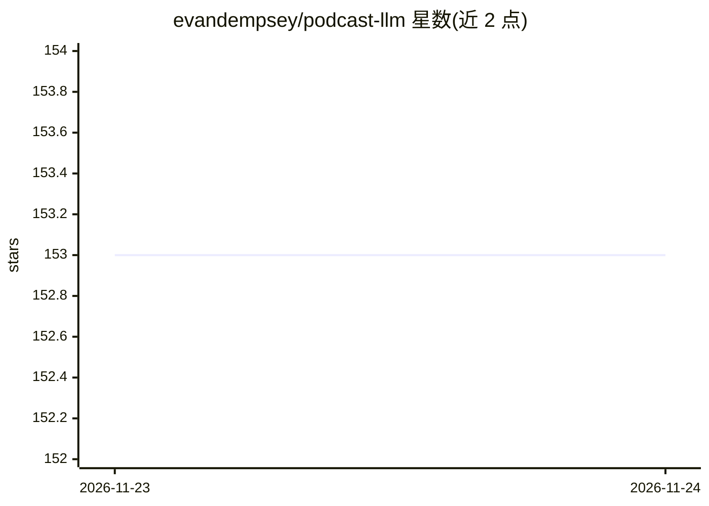

# evandempsey/podcast-llm

⭐ 153 · Python · NOASSERTION · 推送 2026-11-22 · [GitHub](https://github.com/evandempsey/podcast-llm) · [官网](https://evandempsey.github.io/podcast-llm/) · 个人维护

**仅凭标题自动生成 AI 对话播客的命令行/网页工具**

用 LLM 与 TTS 自动生成播客对话：研究模式通过 Tavily 搜索自动收集内容，上下文模式从用户提供的 URL 和文件生成；流程包括大纲生成、多轮 Q&A 脚本写作、Google Cloud 或 ElevenLabs 语音合成，支持断点续跑与 Gradio 网页界面。以 pip 包分发，需配置 OpenAI/Google/ElevenLabs/Tavily/Anthropic 等 API key。许可为 CC BY-NC 4.0（非商业）。

## 筛选速览

| 维度 | 判定 | 备注 |
|---|---|---|
| AI 角色 | `ai-native` | 本体是模型或模型工具 |
| 许可风险 | `none` | NOASSERTION |
| 部署形态 | `library` | 以包/库形式分发 |
| 模型依赖 | — | README 未给出锁定关系 |
| 硬件要求 | — | 无带数字的原话,不猜 |
| 安装摩擦 | `low` | 无编译、无系统依赖或容器化 |
| 成熟度 | — | 结构信号不足 |

## 能力要点

- 研究模式自动搜索收集内容，上下文模式读取 URL 与文件
- 多轮 Q&A 对话脚本生成与动态大纲
- Google Cloud / ElevenLabs 双 TTS 后端，可配置多说话人语音
- 检查点保存进度与 Gradio 网页界面

## 适用场景

- 输入一个话题自动产出完整播客音频
- 把论文或文章转成对话式播客
- 为团队批量生成主题播客节目

## 场景标签

`语音合成` `AI 写作` · 领域:内容生成

## 证据(README 行号)

> L10: An intelligent system that automatically generates engaging podcast conversations using LLMs and text-to-speech tec
> L17:  - Research mode: Automated research and content gathering using Tavily search
> L21: - High-quality text-to-speech synthesis using Google Cloud or ElevenLabs

## 星数曲线

2026-11-23 153 → 2026-11-24 153（+0）

---
*卡片 v1 · prompt 1.4 · 生成 2026-11-23 · 置信度 high · 依据 README sha `b764e088cc27` · [字段定义](../../DATASET.md)*
