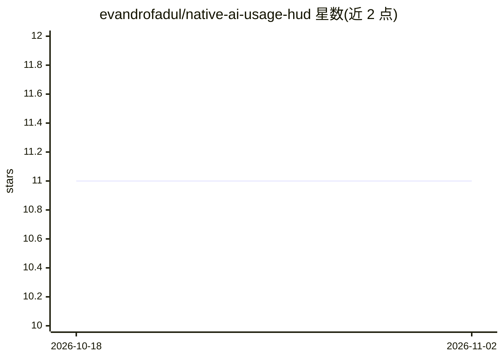

# evandrofadul/native-ai-usage-hud

⭐ 11 · C# · MIT · 推送 2026-09-01 · [GitHub](https://github.com/evandrofadul/native-ai-usage-hud) · 个人维护

**系统托盘 AI 订阅用量监控 HUD：聚合多家配额与重置倒计时**

基于 Avalonia 与 .NET 10 Native AOT 的跨平台（Windows/Linux）系统托盘应用，监控 Anthropic Claude、OpenAI Codex/ChatGPT、GitHub Copilot、Gemini CLI 的计划用量、配额、重置倒计时与节奏。复用官方 CLI 已写入磁盘的凭据，调用相同的用量端点，无需应用内登录；主窗口按厂商分页显示用量仪表、本地 token 统计与每日热力图。提供 59 套内置主题，发布为自包含原生可执行文件。由 Rust 项目 ai-usagebar 移植而来。

## 筛选速览

| 维度 | 判定 | 备注 |
|---|---|---|
| AI 角色 | `ai-ecosystem` | LLM/agent 周边工具 |
| 许可风险 | `permissive` | MIT |
| 部署形态 | `desktop` | 安装包/桌面程序 |
| 模型依赖 | locked-api |  |
| 硬件要求 | — | 无带数字的原话,不猜 |
| 安装摩擦 | `medium` | 含编译或系统依赖之一 |
| 成熟度 | — | 结构信号不足 |

## 能力要点

- 监控 4 家厂商（Claude/Codex/Copilot/Gemini）的用量、配额与重置倒计时
- 复用官方 CLI 磁盘凭据，无单独登录
- Native AOT 编译为自包含原生可执行文件，目标机无需 .NET 运行时
- 59 套内置主题，窗口实时换色

## 适用场景

- 在一个托盘应用里查看多家 AI 订阅的剩余额度
- 跟踪本地 Claude Code / Codex 项目的 token 消耗
- 通过重置倒计时与 pacing 规划当期用量

## 场景标签

`LLM 可观测性` · 领域:评测与运维

## 证据(README 行号)

> L9: **Native-AOT, cross-platform** AI plan-usage monitor (Avalonia) for
> L17: It reuses the credentials the official CLIs already wrote to disk (`claude`,
> L46: The main window shows one tab per vendor with usage gauges, reset countdowns and

## 星数曲线

2026-10-18 11 → 2026-11-02 11（+0）

---
*卡片 v1 · prompt 1.4 · 生成 2026-11-02 · 置信度 high · 依据 README sha `9947f12e2db7` · [字段定义](../../DATASET.md)*
