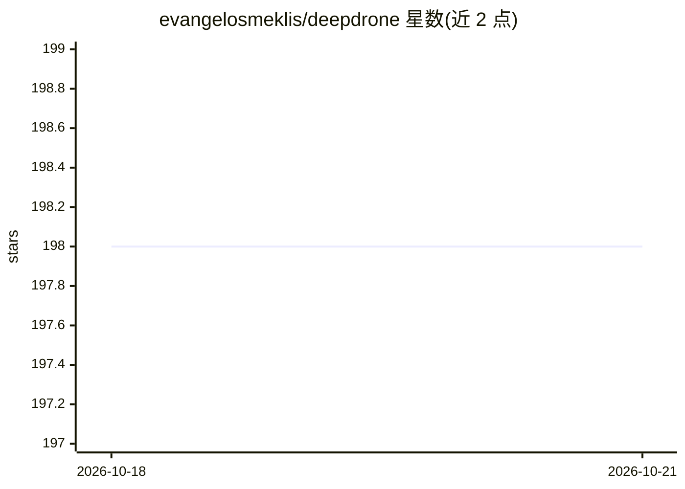

# evangelosmeklis/deepdrone

⭐ 198 · Python · GPL-3.0 · 推送 2026-01-23 · [GitHub](https://github.com/evangelosmeklis/deepdrone) · 个人维护

**用自然语言控制无人机的 AI 应用（含模拟器）**

DeepDrone 是一个通过自然语言对话控制无人机的应用：Web 聊天界面连接 OpenAI、Anthropic、Google 或本地 Ollama 模型（经 LiteLLM），将指令转为飞行操作。支持 DroneKit/MAVLink 连接真实无人机与内置模拟器，另有 Webots C 控制器的直连 UDP 通道（20-50Hz）。提供实时遥测、航点任务规划、会话回放与急停/返航等安全功能。pip 安装依赖后 python3 run.py 即可运行。

## 筛选速览

| 维度 | 判定 | 备注 |
|---|---|---|
| AI 角色 | `ai-native` | 本体是模型或模型工具 |
| 许可风险 | `viral` | GPL-3.0 |
| 部署形态 | `library` | 以包/库形式分发 |
| 模型依赖 | local-ok | 支持本地模型 |
| 硬件要求 | — | 无带数字的原话,不猜 |
| 安装摩擦 | `low` | 无编译、无系统依赖或容器化 |
| 成熟度 | — | 结构信号不足 |

## 能力要点

- 多 AI 提供商接入：OpenAI/Anthropic/Google/本地 Ollama（经 LiteLLM）
- DroneKit 真实无人机控制 + 内置模拟器
- Webots C 控制器直连 UDP 通道（1-3ms 延迟，20-50Hz）
- 实时遥测、航点任务规划、会话回放与急停/返航安全机制

## 适用场景

- 在浏览器里用自然语言指挥无人机起飞、航线飞行与返航
- 无硬件情况下用内置模拟器测试自然语言飞行控制
- 为 Webots 仿真无人机接入低延迟 UDP 控制

## 场景标签

`AI 助手` · 领域:对话与助手

## 证据(README 行号)

> L5: **Control drones with natural language using AI - OpenAI, Anthropic, Google, or local Ollama models.**
> L24: - 🤖 **Multiple AI Providers** - OpenAI, Anthropic, Google, or local Ollama
> L27: - 💬 **Natural Language** - Control drones conversationally

## 星数曲线

2026-10-18 198 → 2026-10-21 198（+0）

---
*卡片 v1 · prompt 1.4 · 生成 2026-10-22 · 置信度 mid · 依据 README sha `ebbb61889bd8` · [字段定义](../../DATASET.md)*
