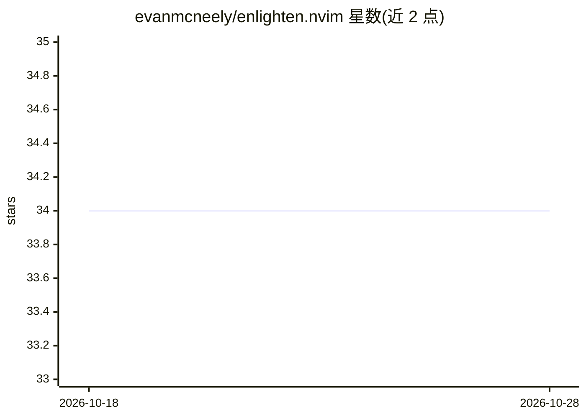

# evanmcneely/enlighten.nvim

⭐ 34 · Lua · ISC · 推送 2026-04-25 · [GitHub](https://github.com/evanmcneely/enlighten.nvim) · 个人维护

**Neovim 插件：在编辑器内用 AI 生成与编辑代码、对话**

将 Neovim 接入 OpenAI 或 Anthropic API 的插件，提供 prompt 生成代码、就地编辑选中代码（diff 高亮显示增删）、编辑器内对话聊天、以对话为上下文编辑 buffer，以及 @files/@target/@buffers/@quickfix 等 @Mentions 上下文注入。支持 OpenAI 与 Anthropic 两类 provider，唯一外部依赖为 curl，需设置 OPENAI_API_KEY 或 ANTHROPIC_API_KEY 环境变量，要求 Neovim 0.10.0+。@Mentions 与从聊天编辑 buffer 的功能标注为实验性。

## 筛选速览

| 维度 | 判定 | 备注 |
|---|---|---|
| AI 角色 | `ai-native` | 本体是模型或模型工具 |
| 许可风险 | `permissive` | ISC |
| 部署形态 | `None` |  |
| 模型依赖 | locked-api |  |
| 硬件要求 | — | 无带数字的原话,不猜 |
| 安装摩擦 | `low` | 无编译、无系统依赖或容器化 |
| 成熟度 | — | 结构信号不足 |

## 能力要点

- prompt 生成代码与选中代码就地编辑（红绿 diff 高亮）
- 编辑器内流式聊天并可用对话作为上下文编辑 buffer
- @files/@buffers/@quickfix 等 @Mentions 注入上下文（实验性）
- 唯一依赖 curl，支持 OpenAI 与 Anthropic provider

## 适用场景

- 在 Neovim 里用自然语言指令修改选中的代码
- 不离开编辑器与模型对话并附带项目文件上下文
- 为不同工作流绑定独立的编辑快捷键与设置

## 场景标签

`代码生成` `AI 助手` · 领域:编码与开发

## 证据(README 行号)

> L15: - Generate code from a prompt.
> L17: - Conversational chat without leaving Neovim.
> L21: - All OpenAI and Anthropic models can be supported (I can't always keep up though).

## 星数曲线

2026-10-18 34 → 2026-10-28 34（+0）

---
*卡片 v1 · prompt 1.4 · 生成 2026-10-25 · 置信度 high · 依据 README sha `19c494895725` · [字段定义](../../DATASET.md)*
