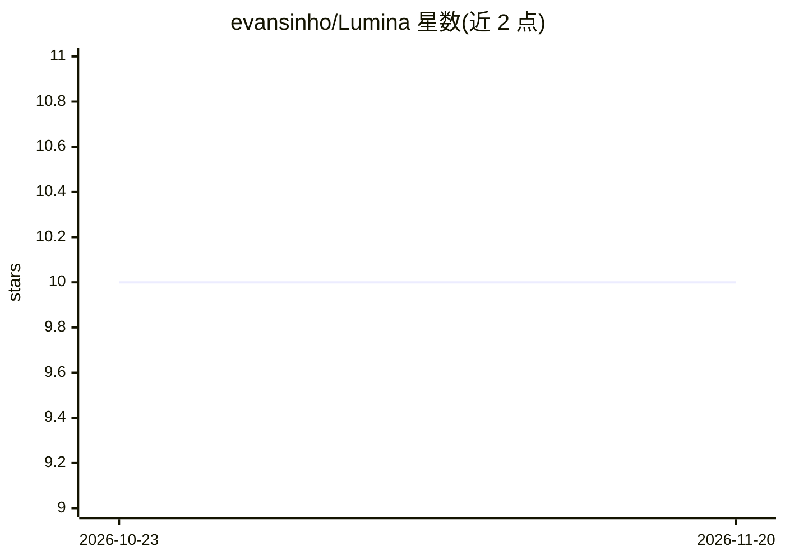

# evansinho/Lumina

⭐ 10 · TypeScript · Apache-2.0 · 推送 2026-11-19 · [GitHub](https://github.com/evansinho/Lumina) · [官网](https://uselumina.io) · 组织维护

**LLM 应用自托管可观测平台：追踪成本、延迟与质量**

基于 OpenTelemetry 标准的自托管 LLM 应用监控平台，提供成本自动计算、分布式层级追踪、基于生产 trace 回放与语义相似度打分的回归测试、阈值告警（Slack/PagerDuty webhook）及实时分析查询。后端为 PostgreSQL 加 NATS 队列，通过 TypeScript/Python SDK 接入，面板为 Next.js 应用。开源版含每日 5 万条 trace、7 天保留的使用限制，全部功能开放；另有托管云版本。

## 筛选速览

| 维度 | 判定 | 备注 |
|---|---|---|
| AI 角色 | `ai-ecosystem` | LLM/agent 周边工具 |
| 许可风险 | `permissive` | Apache-2.0 |
| 部署形态 | `self-host` | docker 或自建部署 |
| 模型依赖 | — | README 未给出锁定关系 |
| 硬件要求 | — | 无带数字的原话,不猜 |
| 安装摩擦 | `low` | 无编译、无系统依赖或容器化 |
| 成熟度 | `idea` | |

## 能力要点

- OpenTelemetry 原生架构，层级 span 追踪 RAG/agent 工作流
- 生产 trace 回放对比与语义相似度回归检测
- 按服务、模型、用户维度的成本自动计算
- 提供 TypeScript/Python SDK 与 REST 查询 API

## 适用场景

- 监控微服务中所有 LLM 调用的成本与延迟
- 上线前用真实生产查询测试 prompt 修改效果
- 按完整 trace 上下文复现生产问题
- 审计留存全部 AI 交互日志以满足合规要求

## 场景标签

`LLM 可观测性` `模型评测` · 领域:评测与运维

## 证据(README 行号)

> L11: Lumina is an OpenTelemetry-native platform for monitoring LLM applications in production. Track costs, latency, and
> L21: Existing APM tools treat LLM calls as opaque HTTP requests. Lumina provides native observability for AI systems wit

## 星数曲线

2026-10-23 10 → 2026-11-20 10（+0）

---
*卡片 v1 · prompt 1.4 · 生成 2026-11-19 · 置信度 high · 依据 README sha `a75e3d678194` · [字段定义](../../DATASET.md)*
