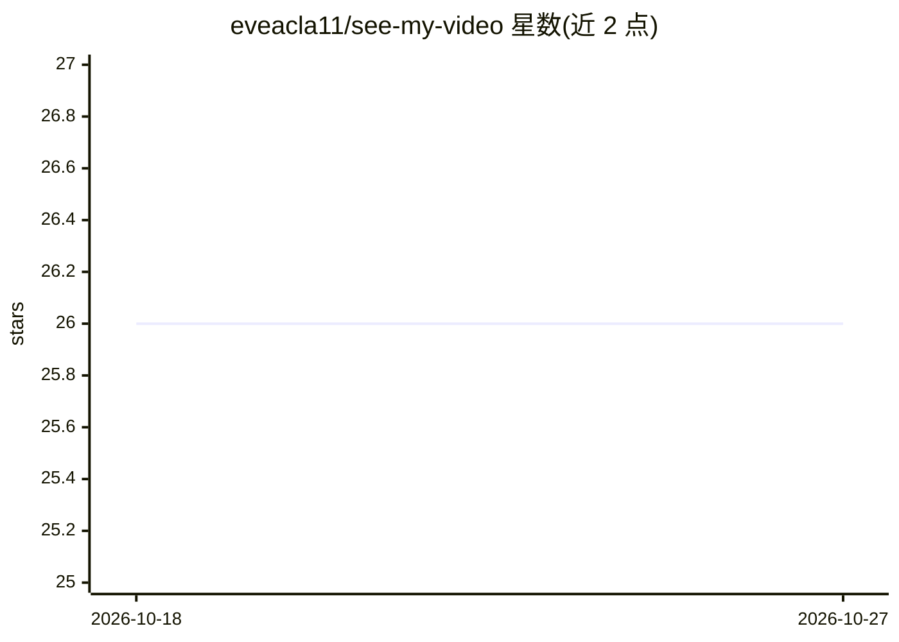

# eveacla11/see-my-video

⭐ 26 · Python · MIT · 推送 2026-08-07 · [GitHub](https://github.com/eveacla11/see-my-video) · 个人维护 · 中文 README

**让 AI 能"看"视频的踩坑教程与脚本：抽帧、切片上传、转码播放**

一篇中文踩坑记录加可运行代码片段：用 ffmpeg 按画面变化抽关键帧并标注时间戳，把帧列表写进提示词或经 base64 直接发给 Claude API，使模型逐帧"观看"视频；另记录自建服务器上传视频的两个问题及解法（4MB 切片上传绕过反代约 100 秒超时、ffmpeg 转低码率 faststart 播放版）。提供抽帧脚本、API 调用片段、FastAPI 服务端与前端上传片段；声音转写部分仅给出方案未实现。适用对象为自建 AI 服务、自行接前端调 API 的开发者。

## 筛选速览

| 维度 | 判定 | 备注 |
|---|---|---|
| AI 角色 | `ai-knowledge` | 知识聚合/清单类 |
| 许可风险 | `permissive` | MIT |
| 部署形态 | `None` |  |
| 模型依赖 | locked-api |  |
| 硬件要求 | — | 无带数字的原话,不猜 |
| 安装摩擦 | `medium` | 含编译或系统依赖之一 |
| 成熟度 | — | 结构信号不足 |

## 能力要点

- 按场景变化（gt(scene,0.25)）抽帧并保留每帧时间戳，静态视频回退均匀取样
- api_snippet.py 将帧转 base64 直接塞进 messages 供 Claude API 读取
- 4MB 切片上传绕过 Cloudflare 隧道约 100 秒单请求上限
- ffmpeg 转低码率 +faststart 播放版（实测 21.8MB→0.6MB）

## 适用场景

- 我自建的 AI 服务想让模型看懂我发的视频
- 家用隧道下大视频上传总是 100% 后失败，需要切片上传方案
- 视频传上去了但播放卡在第一帧，需要转低码率播放版

## 场景标签

`教程课程` · 领域:学习与行业

## 证据(README 行号)

> L3: **一份踩坑记录：把视频喂给 AI，以及在自建服务器上传视频会遇到的两个隐形陷阱。**
> L12: |文件|是什么|

## 星数曲线

2026-10-18 26 → 2026-10-27 26（+0）

---
*卡片 v1 · prompt 1.4 · 生成 2026-10-26 · 置信度 high · 依据 README sha `356e13ebcc99` · [字段定义](../../DATASET.md)*
