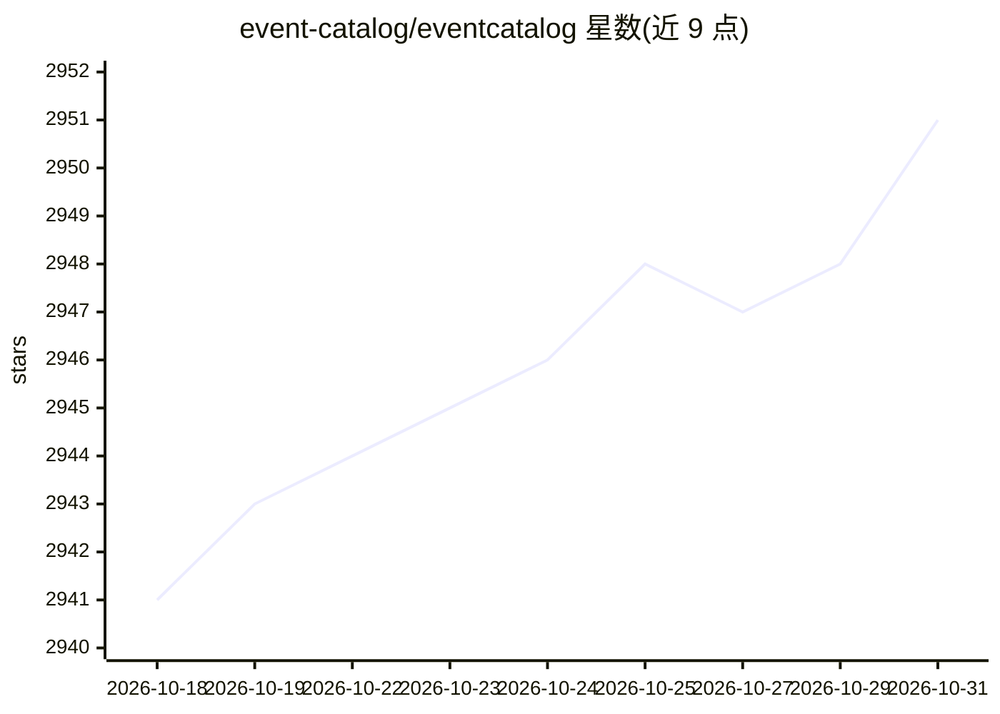

# event-catalog/eventcatalog

⭐ 2,951 · TypeScript · NOASSERTION · 推送 2026-10-30 · [GitHub](https://github.com/event-catalog/eventcatalog) · [官网](https://eventcatalog.dev) · 组织维护

**面向软件架构的文档工具，含 AI 问答与 MCP 服务**

用于记录软件架构的文档工具：覆盖域、服务、消息与 Schema 的编写与版本化，提供架构可视化、Schema 浏览器（OpenAPI/AsyncAPI/Protobuf 等）、业务流程文档与 15+ 生成器（从 AsyncAPI/OpenAPI/Kafka 等自动生成）。AI 部分：内置自然语言 AI 聊天与 MCP 服务器，供人和工具查询目录内容。通过 npx 脚手架创建，本地 3000 端口运行；采用 BSL 1.1 源码可用许可，年收入与融资均低于 1000 万美元的组织免费使用，否则需订阅。

## 筛选速览

| 维度 | 判定 | 备注 |
|---|---|---|
| AI 角色 | `ai-enhanced` | 去掉 AI 部分产品仍成立 |
| 许可风险 | `none` | NOASSERTION |
| 部署形态 | `library` | 以包/库形式分发 |
| 模型依赖 | — | README 未给出锁定关系 |
| 硬件要求 | — | 无带数字的原话,不猜 |
| 安装摩擦 | `low` | 无编译、无系统依赖或容器化 |
| 成熟度 | — | 结构信号不足 |

## 能力要点

- 内置 AI 聊天与 MCP 服务器，可用自然语言查询架构目录
- 支持 OpenAPI/AsyncAPI/Protobuf/JSON Schema/Avro 等 Schema 浏览与字段检索
- 15+ 生成器从 AsyncAPI、OpenAPI、Kafka、Confluent、AWS EventBridge 等自动生成文档
- 资源支持语义版本化与企业特性（OAuth2、RBAC、破坏性变更检测）

## 适用场景

- 为微服务/事件驱动架构编写和维护团队文档
- 把架构决策记录、运行手册等文档与域、服务一起版本化管理
- 让团队成员和 AI 工具通过自然语言或 MCP 查询架构信息
- 从 AsyncAPI/OpenAPI/Kafka 等现有规范自动生成目录文档

## 场景标签

`知识库管理` `文档问答` · 领域:知识与检索

## 证据(README 行号)

> L3: ## The source-available documentation tool for software architectures.
> L42: Ask questions about your architecture and business in natural language. The built-in AI chat and MCP server let you

## 星数曲线

2026-10-18 2,941 → 2026-10-31 2,951（+10）

---
*卡片 v1 · prompt 1.4 · 生成 2026-10-21 · 置信度 high · 依据 README sha `9c2e784c1936` · [字段定义](../../DATASET.md)*
