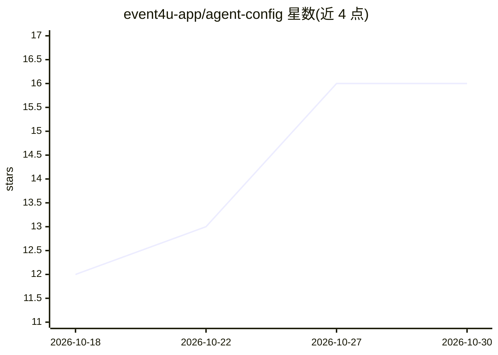

# event4u-app/agent-config

⭐ 16 · TypeScript · MIT · 推送 2026-10-29 · [GitHub](https://github.com/event4u-app/agent-config) · [官网](https://event4u.app) · 组织维护

**面向 20 种宿主 AI 编码工具的技能/规则/命令治理配置层**

通过 npm 分发的 agent 内容层：将技能、规则、命令、准则与人设编译为各宿主 AI 工具（Claude Code、Cursor、Copilot 等 20 种）的原生配置格式，含按意图加载技能的能力路由器与多 agent 编排。提供六种角色入口（开发者/创始人/内容/代理/财务/运维）、四条端到端工作流、安装向导与作用域守卫。README 声称全部公开断言由 CI 机器核验（含徽章计数），并采用无强制守护进程、无独立状态库的设计。技能蒸馏自 TypeScript/PHP 生产代码库，README 自述其他技术栈覆盖未经证实。

## 筛选速览

| 维度 | 判定 | 备注 |
|---|---|---|
| AI 角色 | `ai-ecosystem` | LLM/agent 周边工具 |
| 许可风险 | `permissive` | MIT |
| 部署形态 | `library` | 以包/库形式分发 |
| 模型依赖 | — | README 未给出锁定关系 |
| 硬件要求 | — | 无带数字的原话,不猜 |
| 安装摩擦 | `low` | 无编译、无系统依赖或容器化 |
| 成熟度 | — | 结构信号不足 |

## 能力要点

- 技能/规则编译进 20 种宿主 AI 工具的原生配置格式
- capability router 按意图加载技能，附多 agent 编排与共识评审
- npx 一条命令安装，检测已装 AI 工具并预选，支持 --dry-run 与 headless
- README 公开断言绑定可解析证据，计数由 CI 重新推导核验

## 适用场景

- 让 Claude Code/Cursor 等编码 agent 获得一套治理过的技能与命令集
- 按角色（开发者/内容创作者/财务等）选择聚焦的命令集
- 在团队中统一多个 AI 编码工具的规则与工作流配置

## 场景标签

`多智能体` `提示工程` · 领域:Agent 开发

## 证据(README 行号)

> L32: **A deep library of skills, commands and governed rules** — plus a capability router that loads the right skill on 
> L190: A **content layer** — skills, rules, commands, guidelines, personas — distributed via npm and projected into every

## 星数曲线

2026-10-18 12 → 2026-10-30 16（+4）

---
*卡片 v1 · prompt 1.4 · 生成 2026-10-30 · 置信度 high · 依据 README sha `da326fd1e25a` · [字段定义](../../DATASET.md)*
