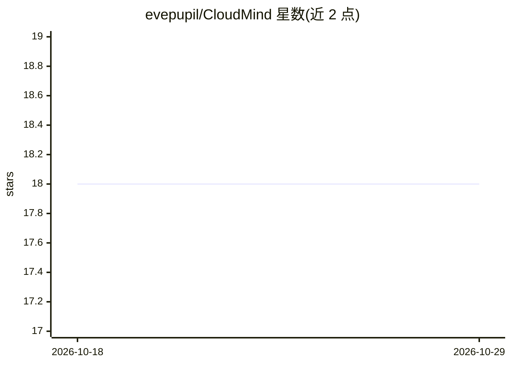

# evepupil/CloudMind

⭐ 18 · TypeScript · 推送 2026-08-14 · [GitHub](https://github.com/evepupil/CloudMind) · 个人维护 · 中文 README

**运行在用户自有 Cloudflare 账号中的 BYOC 个人 AI 记忆层**

CloudMind 是部署在用户自己 Cloudflare 账号里的 AI 记忆层：采集 URL、笔记和 PDF，经队列驱动的工作流做摘要、分块、embedding、实体提取与知识调和，写入三层记忆结构（来源层/语义记忆层/记忆面）。检索支持 Vectorize 语义、D1 FTS5/BM25、图检索与 RRF 融合，并通过无状态 HTTP MCP Server 向 AI 客户端提供 20 个分组工具（记忆动词、资料库搜索、问答、资产管理、运维）。面向希望掌控个人数据的 AI 用户与 Agent 使用场景，依赖 Node.js 24 与 Wrangler 部署到 D1/R2/Vectorize/Queues/Workers AI。

## 筛选速览

| 维度 | 判定 | 备注 |
|---|---|---|
| AI 角色 | `ai-ecosystem` | LLM/agent 周边工具 |
| 许可风险 | `none` | — |
| 部署形态 | `library` | 以包/库形式分发 |
| 模型依赖 | — | README 未给出锁定关系 |
| 硬件要求 | — | 无带数字的原话,不猜 |
| 安装摩擦 | `low` | 无编译、无系统依赖或容器化 |
| 成熟度 | — | 结构信号不足 |

## 能力要点

- 三层记忆模型：不可变来源、D1 知识图谱、Web/MCP 记忆面
- MCP Server 提供 20 个工具（记忆动词、资料库、问答、运维）
- 混合检索：语义 + BM25 + 图检索 + RRF 融合 + 重排
- 带校验和的完整数据导出、离线校验与隔离资源恢复

## 适用场景

- 让 AI 客户端通过 MCP 读写我的个人记忆和资料库
- Agent 跨会话保存与恢复项目决策、进度和工作记忆
- 在自有 Cloudflare 账号中保存可导出、可迁移的私有知识库

## 场景标签

`知识库管理` `知识图谱` `RAG` `Agent 记忆` · 领域:Agent 开发

## 证据(README 行号)

> L36: 它可以收集 URL、笔记和 PDF，提取并调和知识，通过全文、语义和知识图谱多个渠道
> L246: CloudMind 在 `POST /mcp` 提供无状态 HTTP MCP Server。请求需要携带从
> L257: |个人记忆|`remember`、`recall`、`update_memory`、`forget`、`restore_memory`|

## 星数曲线

2026-10-18 18 → 2026-10-29 18（+0）

---
*卡片 v1 · prompt 1.4 · 生成 2026-10-29 · 置信度 mid · 依据 README sha `bbc30bedb000` · [字段定义](../../DATASET.md)*
