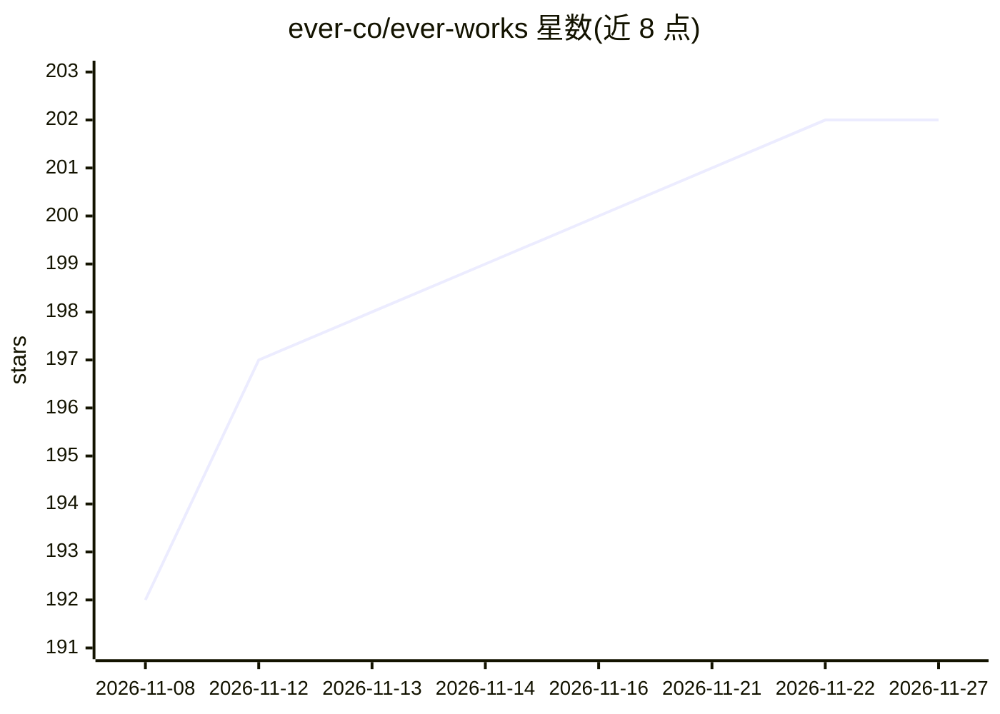

# ever-co/ever-works

⭐ 202 · TypeScript · AGPL-3.0 · 推送 2026-11-26 · [GitHub](https://github.com/ever-co/ever-works) · [官网](https://ever.works) · 组织维护

**让 AI agents 自主研究、生成并部署整站/业务的开源运行时**

开源的 agentic runtime 平台：输入一个想法后，由可配置的多步骤 agent 流水线完成自主调研、长文内容生成、完整站点/仓库代码生成，并部署到用户选择的目标；代码与内容均存于 Git，支持按计划持续更新。采用 Turborepo monorepo，包含 API、Web UI、CLI、MCP server 等多个应用；AI 能力通过插件系统接入多家模型提供商，经 OpenRouter 等网关调用，自带内容管理、订阅计费、监控等模块。AGPL-3.0 许可，可用 Docker Compose 或源码自托管，另有处于 pre-release 的 SaaS 版。

## 筛选速览

| 维度 | 判定 | 备注 |
|---|---|---|
| AI 角色 | `ai-native` | 本体是模型或模型工具 |
| 许可风险 | `viral` | AGPL-3.0 |
| 部署形态 | `self-host` | docker 或自建部署 |
| 模型依赖 | local-ok | 支持本地模型 |
| 硬件要求 | — | 无带数字的原话,不猜 |
| 安装摩擦 | `low` | 无编译、无系统依赖或容器化 |
| 成熟度 | `idea` | |

## 能力要点

- Idea-to-site：单条 prompt 驱动调研、写作、编码、部署的 15 步标准流水线
- 多提供商 AI 插件（OpenAI/Anthropic/Google/Groq/Mistral/Ollama），默认经 OpenRouter 网关
- 代码与内容统一存于 Git，每次变更即提交，支持社区 PR 回流
- 同时提供 Web UI、REST API、CLI、MCP server 多种操作面

## 适用场景

- 用一个 prompt 快速生成内容型站点（如目录站）并持续自动更新
- 自托管平台让 agents 7x24 维护自己的内容与代码资产
- 通过 MCP server 把平台能力暴露给 IDE 与其他 AI agents
- 以无头 API 程序化批量生成与部署站点

## 场景标签

`代码生成` `编码 Agent` · 领域:编码与开发

## 证据(README 行号)

> L11: [Ever® Works™][uri_everworks] - **The Workshop for AI** - an open-source, extensible, **agentic runtime** that auto
> L16: - ✍️ **AI content generation** — long-form, structured, ready-to-publish content
> L34: - **Multi-provider AI** — bring your own models and keys (OpenAI, Anthropic, Google, Groq, Mistral, Ollama, and mor

## 星数曲线

2026-11-08 192 → 2026-11-27 202（+10）

---
*卡片 v1 · prompt 1.4 · 生成 2026-11-25 · 置信度 low · 依据 README sha `490efd3b4070` · [字段定义](../../DATASET.md)*
