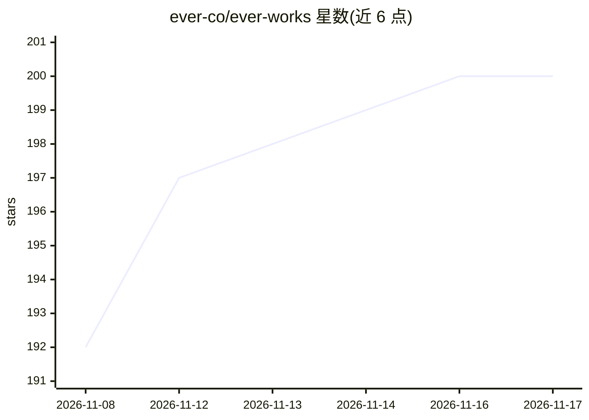

# ever-co/ever-works

⭐ 200 · TypeScript · AGPL-3.0 · 推送 2026-11-16 · [GitHub](https://github.com/ever-co/ever-works) · [官网](https://ever.works) · 组织维护

**自主运营整站业务的 agentic runtime：从创意到建站发布**

开源 agentic runtime 平台：给定一个想法后，AI agent 自主完成研究、内容生成、完整站点/仓库代码生成、多目标部署与按计划的持续改进；代码与内容均以 Git 管理。多模型接入由自带密钥，经 OpenRouter 等网关支持 OpenAI/Anthropic/Google/Groq/Mistral/Ollama 等，并提供插件系统扩展搜索、提取、部署与流水线。Turborepo/pnpm monorepo，含 Web UI、REST API、CLI、Admin、MCP server 与文档站；Docker Compose 快速启动，生产建议 Kubernetes+PostgreSQL+Redis。AGPL-3.0 许可，由 Ever Co. LTD 维护。

## 筛选速览

| 维度 | 判定 | 备注 |
|---|---|---|
| AI 角色 | `ai-native` | 本体是模型或模型工具 |
| 许可风险 | `viral` | AGPL-3.0 |
| 部署形态 | `self-host` | docker 或自建部署 |
| 模型依赖 | local-ok | 支持本地模型 |
| 硬件要求 | — | 无带数字的原话,不猜 |
| 安装摩擦 | `low` | 无编译、无系统依赖或容器化 |
| 成熟度 | `idea` | |

## 能力要点

- idea-to-site 自动化：单一 prompt 产出研究、内容、代码并部署
- 多提供商 AI 接入（OpenAI/Anthropic/Google/Groq/Mistral/Ollama）经 OpenRouter 等网关
- 一等公民插件系统：AI 提供商、搜索、提取、Git、部署、流水线等均可扩展
- MCP server、Headless REST API 与 CLI 三种自动化入口

## 适用场景

- 输入一个点子让 AI agent 自动研究并生成、部署完整网站
- 持续按计划更新和维护 AI 生成的站点内容
- 通过 MCP/API/CLI 将平台能力接入 agent 或 IDE 自动化流程

## 场景标签

`编码 Agent` `Agent 框架` · 领域:Agent 开发

## 证据(README 行号)

> L11: [Ever® Works™][uri_everworks] - **The Workshop for AI** - an open-source, extensible, **agentic runtime** that auto
> L30: - **Idea-to-site automation** — turn a single prompt into a researched, written, coded, and deployed result

## 星数曲线

2026-11-08 192 → 2026-11-17 200（+8）

---
*卡片 v1 · prompt 1.4 · 生成 2026-11-17 · 置信度 mid · 依据 README sha `de90febaf847` · [字段定义](../../DATASET.md)*
