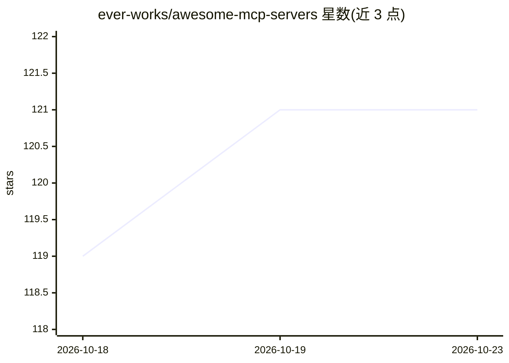

# ever-works/awesome-mcp-servers

⭐ 121 · CC-BY-SA-4.0 · 推送 2026-08-04 · [GitHub](https://github.com/ever-works/awesome-mcp-servers) · [官网](https://mcpserver.ever.works) · 组织维护

**MCP Server 精选目录：聚合各类 MCP 服务器条目**

由 Ever Works 维护的 Model Context Protocol（MCP）服务器策展清单，收录云计算与 DevOps 等类目下的 MCP 服务器、库与工具条目，每条含名称、功能描述与标签，并链接到对应的详情页。条目覆盖 AWS、Google Cloud、Azure、Cloudflare、Kubernetes、Terraform、CI/CD 等场景的官方与第三方 MCP 服务器。目录基于 Ever Works Directory Builder 平台构建并维护，公开网站基于开源 Directory Website Template。

## 筛选速览

| 维度 | 判定 | 备注 |
|---|---|---|
| AI 角色 | `ai-knowledge` | 知识聚合/清单类 |
| 许可风险 | `viral` | CC-BY-SA-4.0 |
| 部署形态 | `library` | 以包/库形式分发 |
| 模型依赖 | — | README 未给出锁定关系 |
| 硬件要求 | — | 无带数字的原话,不猜 |
| 安装摩擦 | `low` | 无编译、无系统依赖或容器化 |
| 成熟度 | — | 结构信号不足 |

## 能力要点

- 按类目组织的 MCP 服务器条目（含名称、描述与标签）
- 覆盖 Cloud & DevOps 场景下 AWS/GCP/Azure/Kubernetes/Terraform 等官方与第三方服务器
- 由 Ever Works Directory Builder 平台构建并维护

## 适用场景

- 查找适用于 AWS/Kubernetes/Terraform 等场景的 MCP 服务器
- 了解 MCP 服务器生态中各云厂商的官方实现
- 为 AI 助手选型可接入的基础设施类 MCP 工具

## 场景标签

`精选清单` · 领域:学习与行业

## 证据(README 行号)

> L1: # Awesome MCP Servers
> L3: A curated list of the best MCP Servers, featuring top solutions, libraries, tools, and more.
> L7: This directory was built and is maintained using the Ever Works Directory Builder platform.

## 星数曲线

2026-10-18 119 → 2026-10-23 121（+2）

---
*卡片 v1 · prompt 1.4 · 生成 2026-10-23 · 置信度 high · 依据 README sha `6f3bfa9222de` · [字段定义](../../DATASET.md)*
