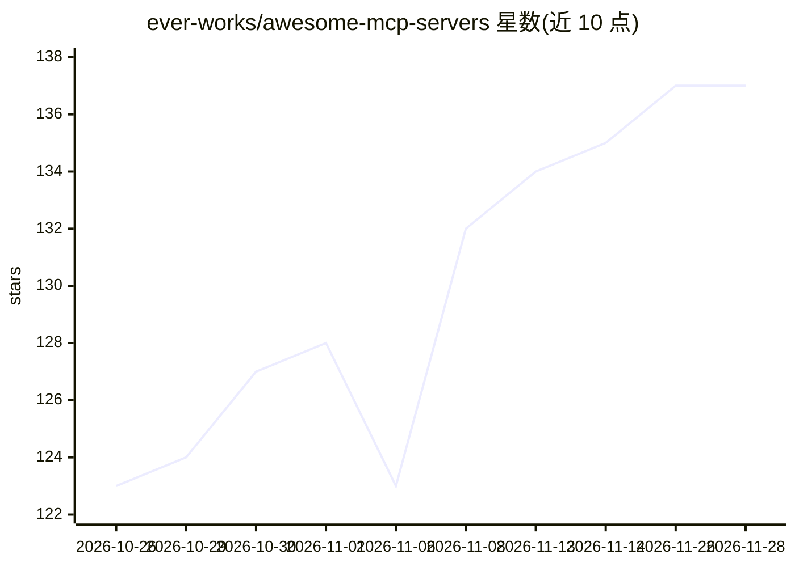

# ever-works/awesome-mcp-servers

⭐ 137 · CC-BY-SA-4.0 · 推送 2026-11-27 · [GitHub](https://github.com/ever-works/awesome-mcp-servers) · [官网](https://mcpserver.ever.works) · 组织维护

**MCP 服务器目录清单：收录 4,240 条分类条目供检索**

以目录网站 mcpserver.ever.works 为主入口的 MCP 服务器编目清单，GitHub 页面按 184 个类别分页组织，覆盖开发工具、云平台、数据库、金融数据、知识管理等条目（合计 4,240 项）。README 由 Ever Works Directory Builder 平台维护，条目附标签与简介；另有 Featured 区块列出 AWS、Azure、Cloudflare、GCP、GitHub 等官方 MCP 服务器。未提供安装说明。

## 筛选速览

| 维度 | 判定 | 备注 |
|---|---|---|
| AI 角色 | `ai-knowledge` | 知识聚合/清单类 |
| 许可风险 | `viral` | CC-BY-SA-4.0 |
| 部署形态 | `library` | 以包/库形式分发 |
| 模型依赖 | — | README 未给出锁定关系 |
| 硬件要求 | — | 无带数字的原话,不猜 |
| 安装摩擦 | `low` | 无编译、无系统依赖或容器化 |
| 成熟度 | — | 结构信号不足 |

## 能力要点

- 4,240 条 MCP 服务器条目，184 个分类分页组织
- 网站端提供浏览与搜索功能
- Featured 区块收录 AWS/Azure/Cloudflare/GCP/GitHub 等官方 MCP 服务器条目

## 适用场景

- 为 AI 应用查找特定领域的 MCP 服务器
- 了解 MCP 服务器生态的覆盖范围与分类
- 查阅云厂商官方 MCP 服务器的入口信息

## 场景标签

`精选清单` · 领域:学习与行业

## 证据(README 行号)

> L3: A curated list of the best MCP Servers, featuring top solutions, libraries, tools, and more.
> L10: > **4,240 items in 184 categories.** The full list is too large for one GitHub page, so each category has its own p
> L12: ## 📑 Categories

## 星数曲线

2026-10-26 123 → 2026-11-28 137（+14）

---
*卡片 v1 · prompt 1.4 · 生成 2026-11-28 · 置信度 high · 依据 README sha `48a6844a95ae` · [字段定义](../../DATASET.md)*
