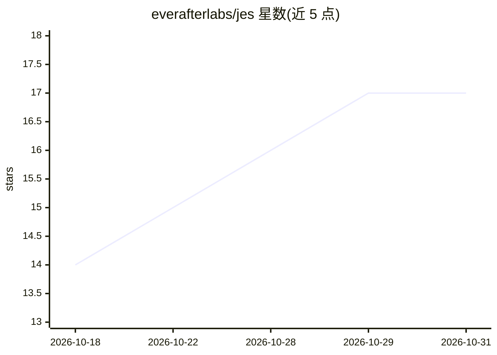

# everafterlabs/jes

⭐ 17 · Python · Apache-2.0 · 推送 2026-10-27 · [GitHub](https://github.com/everafterlabs/jes) · 组织维护

**AI agent 安全防护库：拦截注入/越狱/泄密的工具调用与响应检查**

Apache-2.0 的 Python 库，为 AI agent 各环节（用户输入、检索内容、工具调用、工具结果、模型响应）提供 guardrails。核心机制是用 System One 决策模型（Jev/Laya）做分类判定而非 LLM 生成，攻击文本无法通过指令影响裁决；secrets/PII 在本地先行脱敏后才送模型。提供 LangChain/LangGraph/OpenAI Agents SDK/FastMCP 集成，并支持 Claude Code、Codex 等编码 agent 的 hooks 检查。限制：需 Python 3.11+，决策模型经 TYPESAFE_API_KEY 调用（教程含 Ollama 本地路径）。

## 筛选速览

| 维度 | 判定 | 备注 |
|---|---|---|
| AI 角色 | `ai-ecosystem` | LLM/agent 周边工具 |
| 许可风险 | `permissive` | Apache-2.0 |
| 部署形态 | `library` | 以包/库形式分发 |
| 模型依赖 | local-ok | 支持本地模型 |
| 硬件要求 | — | 无带数字的原话,不猜 |
| 安装摩擦 | `low` | 无编译、无系统依赖或容器化 |
| 成熟度 | — | 结构信号不足 |

## 能力要点

- 决策模型（Jev/Laya）分类而非 LLM 生成，攻击文本不进入指令上下文
- 覆盖 prompt、检索页、工具调用/结果、子 agent 与响应全链路检查
- secrets/PII 本地脱敏，脱敏后才送判定
- 多种内置 guard：注入/工具安全/危害/密钥/隐形字符/正则与自定义 judge

## 适用场景

- 为 LangChain/LangGraph agent 加装提示注入与工具调用防护
- RAG 应用中检查检索片段与模型回答
- 给 Claude Code/Codex 等编码 agent 配置安全 hooks

## 场景标签

`网络安全` · 领域:学习与行业

## 证据(README 行号)

> L5:  Open-source guardrails for AI agents, powered by a decision model, not an LLM.
> L22: - **Every step of the agent.** Prompt, retrieved page, skill, subagent, tool call, tool result and response.

## 星数曲线

2026-10-18 14 → 2026-10-31 17（+3）

---
*卡片 v1 · prompt 1.4 · 生成 2026-10-29 · 置信度 high · 依据 README sha `9e0083448671` · [字段定义](../../DATASET.md)*
