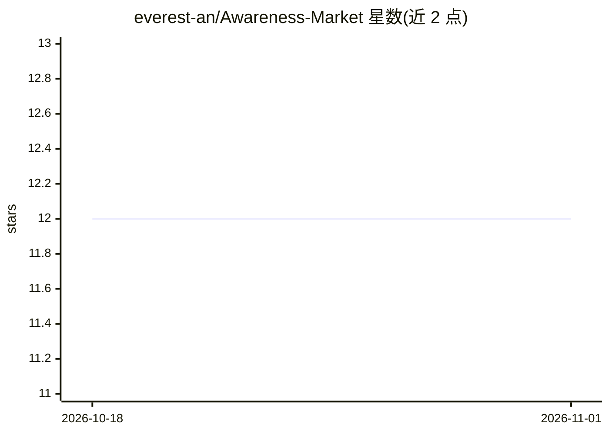

# everest-an/Awareness-Market

⭐ 12 · JavaScript · MIT · 推送 2026-10-29 · [GitHub](https://github.com/everest-an/Awareness-Market) · [官网](https://awareness.market) · 组织维护 · 中文 README

**给 AI 编程代理的本地跨会话记忆插件（MCP 服务器）**

Awareness Local 是面向 AI 编程代理的持久记忆插件，以本地 MCP 服务器 + 守护进程形式运行，支持 Claude Code、Cursor、Copilot、Cline 等 13+ MCP 兼容 IDE。它把决策、方案、风险等记录为机器上的 Markdown 知识卡，用 SQLite FTS5 + 嵌入做关键词+语义混合检索，检索阶段零 LLM 调用，自称 LongMemEval R@5 达 96%。本地模式离线可用、无需账号，云端同步为可选项。安装仅需一条 npx 命令，要求 Node.js 18+，另有 Python/TypeScript SDK 拦截器与 OpenClaw、Claude Code 插件。

## 筛选速览

| 维度 | 判定 | 备注 |
|---|---|---|
| AI 角色 | `ai-ecosystem` | LLM/agent 周边工具 |
| 许可风险 | `permissive` | MIT |
| 部署形态 | `library` | 以包/库形式分发 |
| 模型依赖 | — | README 未给出锁定关系 |
| 硬件要求 | — | 无带数字的原话,不猜 |
| 安装摩擦 | `low` | 无编译、无系统依赖或容器化 |
| 成熟度 | — | 结构信号不足 |

## 能力要点

- 跨会话记忆：以 Markdown 存储决策/方案/风险知识卡
- 混合检索（SQLite FTS5 关键词 + 嵌入语义），检索零 LLM 调用
- 两阶段渐进式披露（摘要→全文）控制 token 用量
- 一条 npx 命令接入 13+ MCP 兼容 IDE，本地离线可用

## 适用场景

- 跨多个会话进行长周期代码库迁移时保留上下文
- 团队交接时让 AI 记住此前实现决策与待办
- 个人编码工作流中持久化偏好与代码约定

## 场景标签

`Agent 记忆` · 领域:Agent 开发

## 证据(README 行号)

> L18: Awareness is a memory plugin for AI coding agents — Cursor, Claude Code, Copilot, Cline, OpenCode, and any MCP clie
> L45: - Local-first MCP server with offline support

## 星数曲线

2026-10-18 12 → 2026-11-01 12（+0）

---
*卡片 v1 · prompt 1.4 · 生成 2026-11-01 · 置信度 high · 依据 README sha `4a7468e8f8e8` · [字段定义](../../DATASET.md)*
