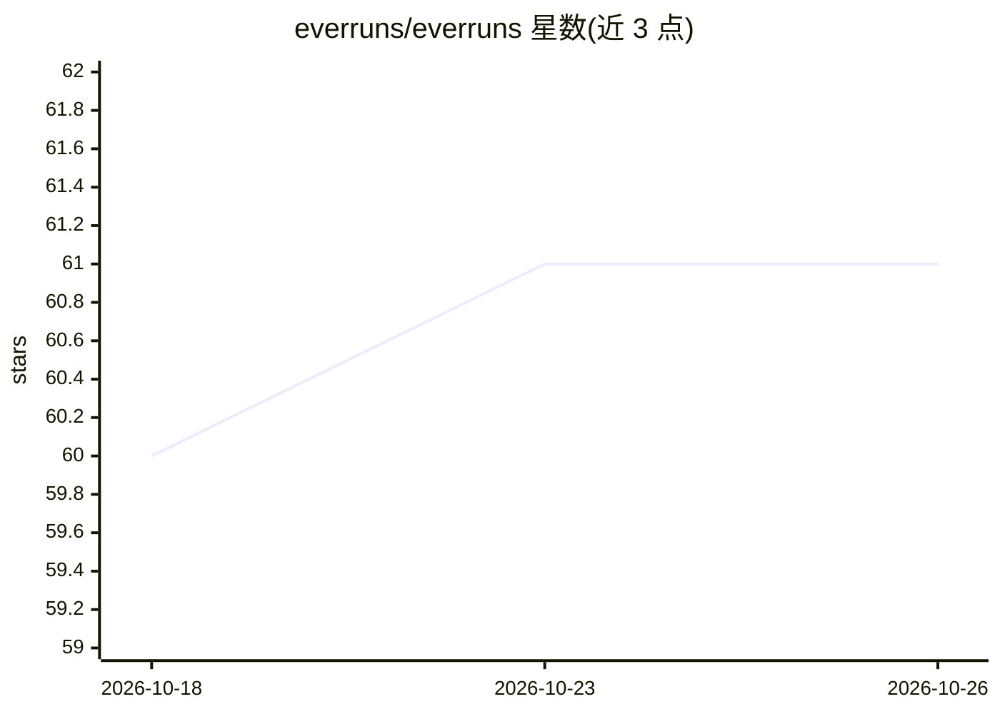

# everruns/everruns

⭐ 61 · Rust · MIT · 推送 2026-10-25 · [GitHub](https://github.com/everruns/everruns) · [官网](https://everruns.com/) · 组织维护

**Rust 构建与运行 AI agent 的框架及自托管平台**

开源 Rust agent 框架：在应用内定义 agent，附加模型与类型化工具（可启用 filesystem/shell/web/Lua/MCP 边界），运行多轮会话并观察执行；提供事件、取消、生命周期钩子与持久化选项。模型接入从离线、OpenAI 到自定义 provider。另提供自托管共享运行时平台（Docker Compose 部署），含持久执行、无状态 worker 池、Web UI、远程 API、Slack/语音/MCP 等渠道发布，以及 Everruns Cloud 托管选项。README 声明处于活跃开发、功能可能快速变化。

## 筛选速览

| 维度 | 判定 | 备注 |
|---|---|---|
| AI 角色 | `ai-ecosystem` | LLM/agent 周边工具 |
| 许可风险 | `permissive` | MIT |
| 部署形态 | `self-host` | docker 或自建部署 |
| 模型依赖 | — | README 未给出锁定关系 |
| 硬件要求 | — | 无带数字的原话,不猜 |
| 安装摩擦 | `low` | 无编译、无系统依赖或容器化 |
| 成熟度 | `idea` | |

## 能力要点

- Rust 内嵌 agent 循环，类型化工具 schema 由函数推导
- 自托管平台提供持久执行、worker 池、Web UI 与远程 API
- agent 可发布到 Slack、A2A、语音、MCP 等渠道
- 提供 Rust/Python/TypeScript SDK 与 OpenAPI 3.0 接口

## 适用场景

- 在 Rust 应用中内嵌多轮 AI agent 与工具调用
- 自托管运行多租户 agent 平台并获得持久执行保障
- 通过 Slack、Web 聊天、语音等渠道发布 agent

## 场景标签

`Agent 框架` · 领域:Agent 开发

## 证据(README 行号)

> L11: Everruns is an open-source framework for building AI agents directly in Rust
> L15: Use the framework in your application. When you need a shared runtime and
> L72: The Platform, self-hosted or on Everruns Cloud, adds durable execution, a stateless worker

## 星数曲线

2026-10-18 60 → 2026-10-26 61（+1）

---
*卡片 v1 · prompt 1.4 · 生成 2026-10-24 · 置信度 high · 依据 README sha `00b649e6a9a8` · [字段定义](../../DATASET.md)*
