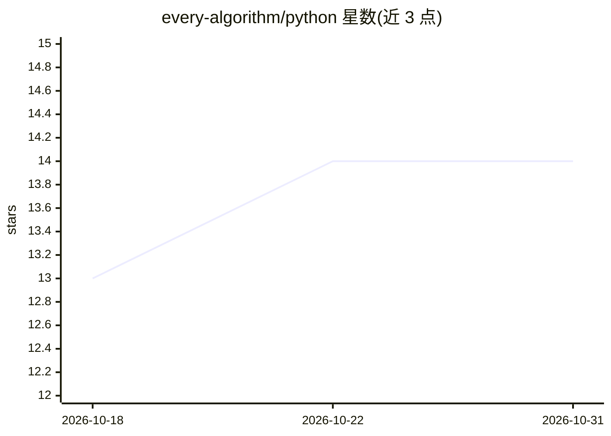

# every-algorithm/python

⭐ 14 · Python · Apache-2.0 · 推送 2025-11-09 · [GitHub](https://github.com/every-algorithm/python) · [官网](https://every-algorithm.github.io/) · 个人维护

**用 Python 实现各类算法的教育性代码合集**

作者以教育为目的、用 Python 逐个实现算法与数据结构的个人项目，主题标签覆盖算法、计算机科学、数据结构、机器学习与面试准备等方向。README 仅说明项目定位与贡献方式（fork 后发 pull request），未给出安装步骤、运行说明或依赖清单。以仓库源码形式提供，适合阅读与学习参考。

## 筛选速览

| 维度 | 判定 | 备注 |
|---|---|---|
| AI 角色 | `ai-knowledge` | 知识聚合/清单类 |
| 许可风险 | `permissive` | Apache-2.0 |
| 部署形态 | `None` |  |
| 模型依赖 | — | README 未给出锁定关系 |
| 硬件要求 | — | 无带数字的原话,不猜 |
| 安装摩擦 | `low` | 无编译、无系统依赖或容器化 |
| 成熟度 | — | 结构信号不足 |

## 能力要点

- 以教育为目的的算法 Python 实现合集
- 主题覆盖算法、数据结构、机器学习、面试准备
- 通过 fork 与 pull request 接受贡献

## 适用场景

- 学习算法与数据结构的 Python 实现
- 面试准备时查阅各类算法实现
- 教学参考材料

## 场景标签

`教程课程` · 领域:学习与行业

## 证据(README 行号)

> L3: For educational purposes, I implemented every algorithm in Python!

## 星数曲线

2026-10-18 13 → 2026-10-31 14（+1）

---
*卡片 v1 · prompt 1.4 · 生成 2026-10-31 · 置信度 low · 依据 README sha `9207a0ba35b6` · [字段定义](../../DATASET.md)*
