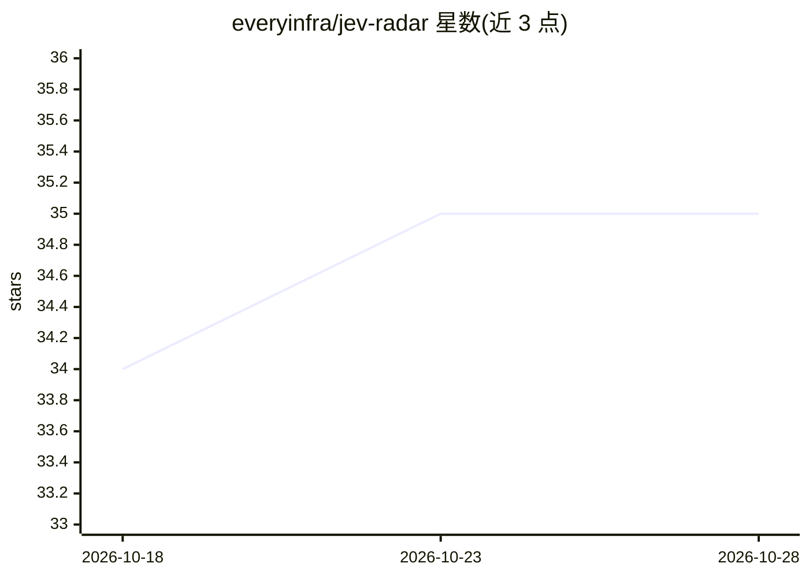

# everyinfra/jev-radar

⭐ 35 · NOASSERTION · 推送 2026-10-27 · [GitHub](https://github.com/everyinfra/jev-radar) · [官网](https://radar.everyinfra.com) · 组织维护 · 中文 README

**Jev（TypeSafe AI System One）生态案例注册表与监控清单**

由 EveryInfra 维护的独立社区研究仓库：追踪 Jev 模型生态的项目案例，含 1,199 条经一手来源验证的注册条目，按 A/B 置信度分级，2026-09-19 起自动化巡检多平台来源并逐日提交。仓库提供完整案例集 CASEBOOK.md、机器可读的 projects.json 注册表、Jev API 申请攻略与一个 SKILL.md 格式的每日简报技能。内容 CC BY 4.0、数据 CC0，声明与 TypeSafe AI 无关联。

## 筛选速览

| 维度 | 判定 | 备注 |
|---|---|---|
| AI 角色 | `ai-knowledge` | 知识聚合/清单类 |
| 许可风险 | `none` | NOASSERTION |
| 部署形态 | `None` |  |
| 模型依赖 | — | README 未给出锁定关系 |
| 硬件要求 | — | 无带数字的原话,不猜 |
| 安装摩擦 | `low` | 无编译、无系统依赖或容器化 |
| 成熟度 | — | 结构信号不足 |

## 能力要点

- 1,199 条条目按 A(0.90)/B(0.75)/C(0.60) 置信度分级，均核对一手出处
- 自动化巡检覆盖 GitHub、X 及五个社区目录站，最近扫描 2026-10-24
- 提供 CASEBOOK 案例集、projects.json 机器可读注册表与 SKILL.md 每日简报技能
- 记录实测教训与失效案例（置信度≠正确性、顺序敏感、假 demo）

## 适用场景

- 了解 Jev 模型生态里大家在构建什么类型的项目
- 获取 Jev API 的申请与免排队接入渠道
- 用注册表数据做生态分析或接入 agent 每日简报

## 场景标签

`精选清单` · 领域:学习与行业

## 证据(README 行号)

> L30: Four days after launch, the Jev ecosystem crossed **1,000 repositories** within five days (21,600+ stars at day 4).
> L83: |`data/projects.json`|Machine-readable registry: uniform schema incl. `verification {tier, method, confidence}`|
> L93: Content: **CC BY 4.0** · Data: **CC0**. Independent community research — **not affiliated with TypeSafe AI**. Metri

## 星数曲线

2026-10-18 34 → 2026-10-28 35（+1）

---
*卡片 v1 · prompt 1.4 · 生成 2026-10-25 · 置信度 high · 依据 README sha `c349c65164d5` · [字段定义](../../DATASET.md)*
