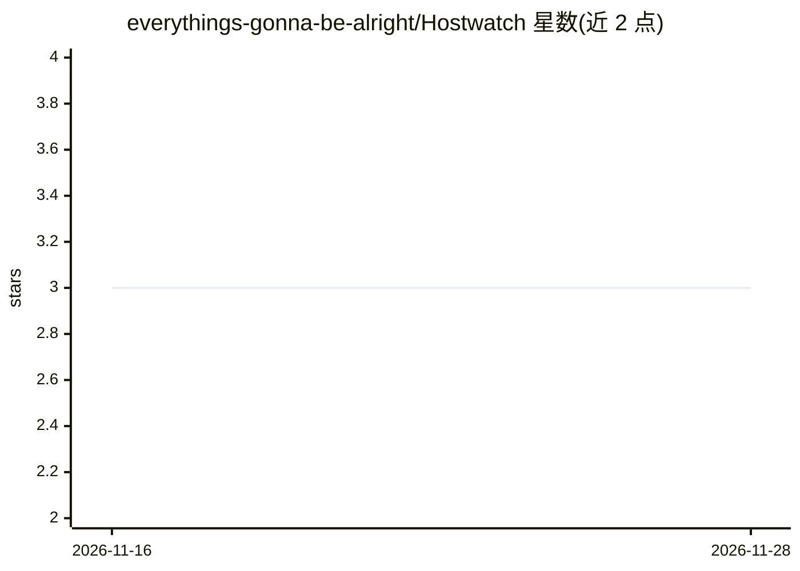

# everythings-gonna-be-alright/Hostwatch

⭐ 3 · Swift · NOASSERTION · 推送 2026-11-24 · [GitHub](https://github.com/everythings-gonna-be-alright/Hostwatch) · [官网](https://hostwatch.tech) · 个人维护

**macOS 行为式入侵检测：学习正常行为并拦截可疑连接与命令**

面向 macOS 的主机入侵检测应用，由 root 后台采集器与 GUI 应用组成，通过 Unix socket 通信。首日学习设备上的正常行为模式，将相关可疑事件串联为故事，展示进程、网络连接与文件操作；可按 Ask/Strict 策略在应用发起新连接前询问或拦截（基于 macOS pf），并检查 Claude Code 命令是否危险。数据本地加密存储，可选接入 Claude 或 Apple 端侧模型进行问答。安装方式为下载签名安装包拖入 /Applications；要求 macOS 26+，状态为 prototype，采用 PolyForm Shield 许可。

## 筛选速览

| 维度 | 判定 | 备注 |
|---|---|---|
| AI 角色 | `ai-enhanced` | 去掉 AI 部分产品仍成立 |
| 许可风险 | `none` | NOASSERTION |
| 部署形态 | `desktop` | 安装包/桌面程序 |
| 模型依赖 | locked-api |  |
| 硬件要求 | — | 无带数字的原话,不猜 |
| 安装摩擦 | `low` | 无编译、无系统依赖或容器化 |
| 成熟度 | `idea` | |

## 能力要点

- 首日学习设备正常行为，异常事件自动串联为可逐条查看的故事
- 防火墙可在应用建立新连接前询问（Ask）或拒绝（Strict），基于 macOS pf 无需扩展
- Claude Code guard 在危险命令执行前拦截或要求确认
- Ask AI 支持 Claude 与 Apple 端侧模型两种选择，数据默认留在本地

## 适用场景

- 监控个人 Mac 上的可疑进程、外连与文件访问
- 拦截未知应用的网络连接或高风险 AI 编码命令
- 排查某进程实际行为并让 AI 解释其风险

## 场景标签

`网络安全` · 领域:学习与行业

## 证据(README 行号)

> L5:  Behavior-based intrusion detection for macOS.
> L69: **🛡️ Stop what you didn't allow** (off until you turn it on)
> L76: **✨ Ask AI** (Claude or Apple's on-device model, your choice)

## 星数曲线

2026-11-16 3 → 2026-11-28 3（+0）

---
*卡片 v1 · prompt 1.4 · 生成 2026-11-22 · 置信度 high · 依据 README sha `382ddc8d0af2` · [字段定义](../../DATASET.md)*
