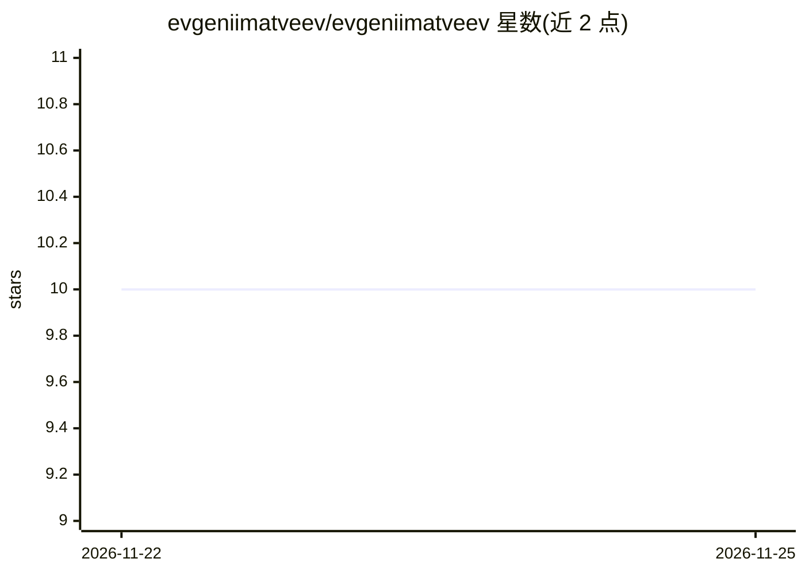

# evgeniimatveev/evgeniimatveev

⭐ 10 · Python · 推送 2026-11-24 · [GitHub](https://github.com/evgeniimatveev/evgeniimatveev) · [官网](https://github.com/evgeniimatveev) · 个人维护

**数据/MLOps 工程师的自更新个人简历档案页**

一个通过 GitHub Actions 每日自动更新的个人 README 档案：自动轮换 370+ 横幅、基于时间/季节算法生成 NLG 动态文案、Shields.io 徽章显示下次更新倒计时，并以 JSONL 遥测与心跳日志记录每次 CI 运行。页面上还嵌入一个回答访客提问的 RAG 问答 widget，并展示作者的数据管道、BI 看板等 20 余个项目。面向招聘方与访客展示工程能力。

## 筛选速览

| 维度 | 判定 | 备注 |
|---|---|---|
| AI 角色 | `ai-enhanced` | 去掉 AI 部分产品仍成立 |
| 许可风险 | `none` | — |
| 部署形态 | `self-host` | docker 或自建部署 |
| 模型依赖 | — | README 未给出锁定关系 |
| 硬件要求 | — | 无带数字的原话,不猜 |
| 安装摩擦 | `low` | 无编译、无系统依赖或容器化 |
| 成熟度 | — | 结构信号不足 |

## 能力要点

- GitHub Actions 定时工作流自动更新 README（5,900+ 次 Auto Update 运行）
- 370+ GIF 横幅轮换与基于时间/季节/星期的 NLG 文案生成
- JSONL 遥测、心跳日志与幂等提交的可观测性设计
- 嵌入基于 Cloudflare Vectorize 与 Claude Haiku 的实时问答 widget

## 适用场景

- 作为个人作品集展示数据工程与 MLOps 项目
- 了解如何用 CI/CD 自动化维护 GitHub 个人主页
- 作为带自更新徽章与遥测的 README 模板参考

## 场景标签

`RAG` · 领域:知识与检索

## 证据(README 行号)

> L32: This profile is a **self-updating MLOps demo** — a living portfolio showcasing production-grade automation.
> L220:  🤖 RAG Ask-Widget — Live on This Profile
> L222:  An interactive Q&A widget embedded on this page, answering visitor questions about my projects and background in 

## 星数曲线

2026-11-22 10 → 2026-11-25 10（+0）

---
*卡片 v1 · prompt 1.4 · 生成 2026-11-22 · 置信度 low · 依据 README sha `7dc8896db7d4` · [字段定义](../../DATASET.md)*
