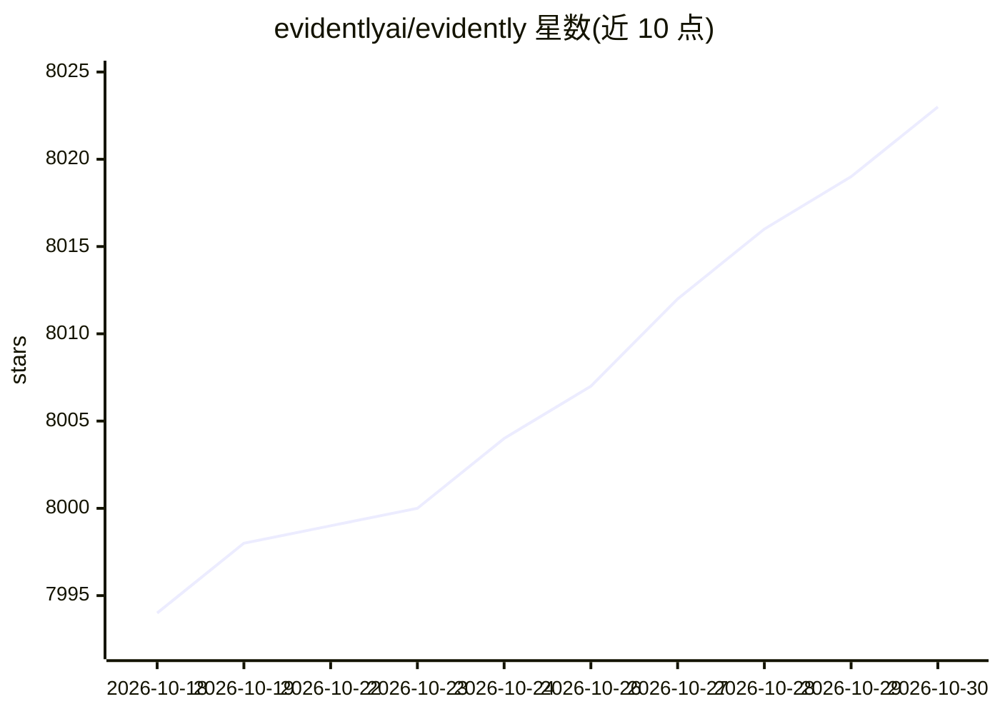

# evidentlyai/evidently

⭐ 8,023 · Jupyter Notebook · Apache-2.0 · 推送 2026-09-29 · [GitHub](https://github.com/evidentlyai/evidently) · [官网](https://discord.gg/xZjKRaNp8b) · 组织维护

**开源 ML/LLM 系统评测、测试与监控框架（100+ 指标）**

Python 库，用于评估、测试和监控 ML 与 LLM 系统，覆盖表格数据与文本、预测任务与生成任务（含 RAG）。提供 100+ 内置指标（数据漂移、数据质量、分类/回归、LLM judges 等）与自定义指标接口。两种工作形态：Report（评估摘要）与 Test Suite（加 pass/fail 条件，用于回归测试/CI/CD/数据校验）；另提供可自托管的监控 UI，或注册托管的 Evidently Cloud。输出支持 HTML/JSON/Python 字典。

## 筛选速览

| 维度 | 判定 | 备注 |
|---|---|---|
| AI 角色 | `ai-ecosystem` | LLM/agent 周边工具 |
| 许可风险 | `permissive` | Apache-2.0 |
| 部署形态 | `library` | 以包/库形式分发 |
| 模型依赖 | — | README 未给出锁定关系 |
| 硬件要求 | — | 无带数字的原话,不猜 |
| 安装摩擦 | `low` | 无编译、无系统依赖或容器化 |
| 成熟度 | — | 结构信号不足 |

## 能力要点

- 100+ 内置指标：数据漂移（20+ 统计检验）、文本描述符、LLM 输出评估、分类/回归/排序/推荐
- Report 可转为带 pass/fail 条件的 Test Suite，支持从参考数据自动生成条件
- 可自托管的监控 UI 仪表盘，另有托管的 Evidently Cloud
- Python 接口编写自定义指标

## 适用场景

- 对模型/数据管道做离线评估与数据漂移检测
- 在 CI/CD 中对模型与数据做回归测试
- 上线后自托管监控面板持续跟踪 ML/LLM 系统质量
- 对 LLM 输出做情感、毒性、语义相似度等评估

## 场景标签

`模型评测` `LLM 可观测性` `MLOps` · 领域:评测与运维

## 证据(README 行号)

> L3:  An open-source framework to evaluate, test and monitor ML and LLM-powered systems.
> L25: Evidently is an open-source Python library to evaluate, test, and monitor ML and LLM systems—from experiments to pr
> L31: * 🚦 Both offline evals and live monitoring.

## 星数曲线

2026-10-18 7,994 → 2026-10-30 8,023（+29）

---
*卡片 v1 · prompt 1.4 · 生成 2026-10-20 · 置信度 high · 依据 README sha `c5aed5c3b830` · [字段定义](../../DATASET.md)*
