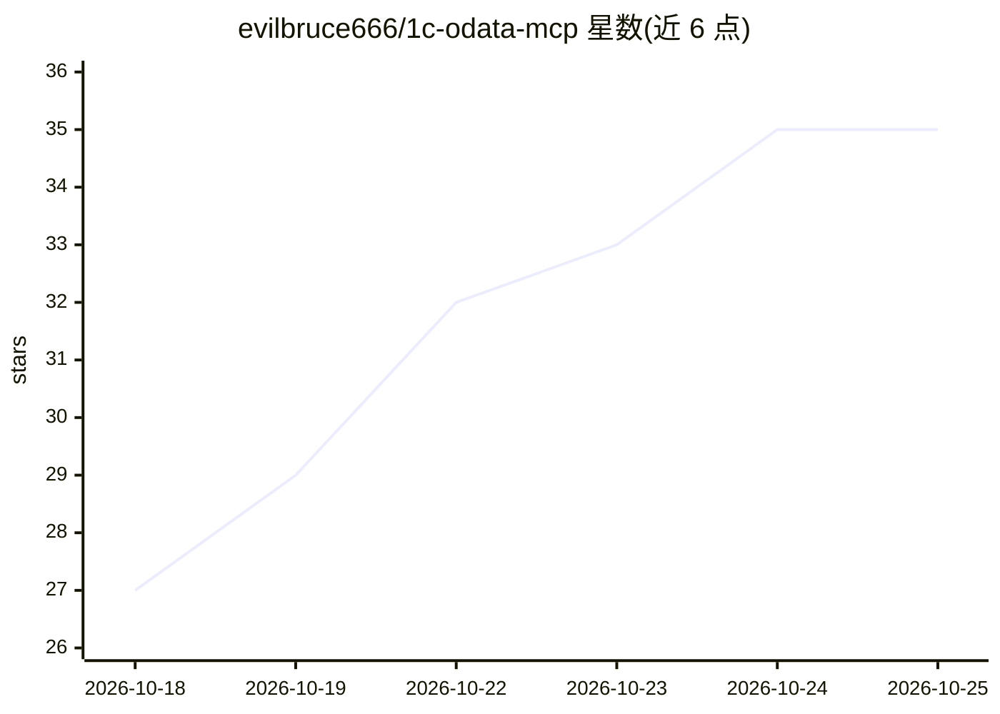

# evilbruce666/1c-odata-mcp

⭐ 35 · TypeScript · MIT · 推送 2026-10-25 · [GitHub](https://github.com/evilbruce666/1c-odata-mcp) · [官网](https://www.npmjs.com/package/1c-odata-mcp) · 个人维护

**把 1С:Предприятие 数据接入任意 MCP 客户端的 OData 连接器**

通过标准 OData 接口把 1С:Предприятие 数据库连接到任意 MCP 客户端（Claude、Cursor、VS Code、JetBrains、LM Studio、Ollama 等本地模型）的 MCP 服务器，以 npm 包发布，npx 一条命令启动。提供 74 个工具（33 读/分析 + 41 写入），覆盖现金/债务晨报、账期应收应付、月末关账检查、对账单、科目卡片、总账等场景；写入需显式开启并带预览确认，默认只读。要求 1С 侧已发布 OData（云/SQL/文件库均可），不使用 COM 或直接访问 SQL；本地进程运行，数据不出用户网络。

## 筛选速览

| 维度 | 判定 | 备注 |
|---|---|---|
| AI 角色 | `ai-ecosystem` | LLM/agent 周边工具 |
| 许可风险 | `permissive` | MIT |
| 部署形态 | `library` | 以包/库形式分发 |
| 模型依赖 | local-ok | 支持本地模型 |
| 硬件要求 | — | 无带数字的原话,不猜 |
| 安装摩擦 | `low` | 无编译、无系统依赖或容器化 |
| 成熟度 | — | 结构信号不足 |

## 能力要点

- 74 个工具：33 个读取/分析 + 41 个写入（写入需预览确认，默认只读）
- 任意 MCP 客户端可用：Claude Desktop、Cursor、VS Code、JetBrains、LM Studio、Ollama
- 内置按角色组织的 MCP prompt 场景（晨报/月末关账检查/对账单）
- 支持多数据库、多法人组织，云/SQL/文件型 1С 均可，仅需已发布 OData

## 适用场景

- 老板或会计在 Claude 里用自然语言查现金、欠款和月末关账问题
- 经理让 AI 生成与客户的对账单数据
- 在本地模型（Ollama/LM Studio）上查询 1С 数据而不让数据出内网

## 场景标签

 · 领域:企业系统集成/ERP-LLM 连接器

## 证据(README 行号)

> L18: > 🇬🇧 **In short:** an MCP server that connects 1C:Enterprise to any MCP client (Claude, Cursor, VS Code, local mode
> L20: **MCP-сервер (Model Context Protocol) для 1С:Предприятие через стандартный интерфейс OData.** Подключает данные 1С 
> L30: - 🔌 Любой **MCP-клиент**: Claude Desktop и Claude Code, ChatGPT для компьютера (через Codex), Cursor, VS Code, JetB

## 星数曲线

2026-10-18 27 → 2026-10-25 35（+8）

---
*卡片 v1 · prompt 1.4 · 生成 2026-10-25 · 置信度 high · 依据 README sha `97ecd88dff02` · [字段定义](../../DATASET.md)*
