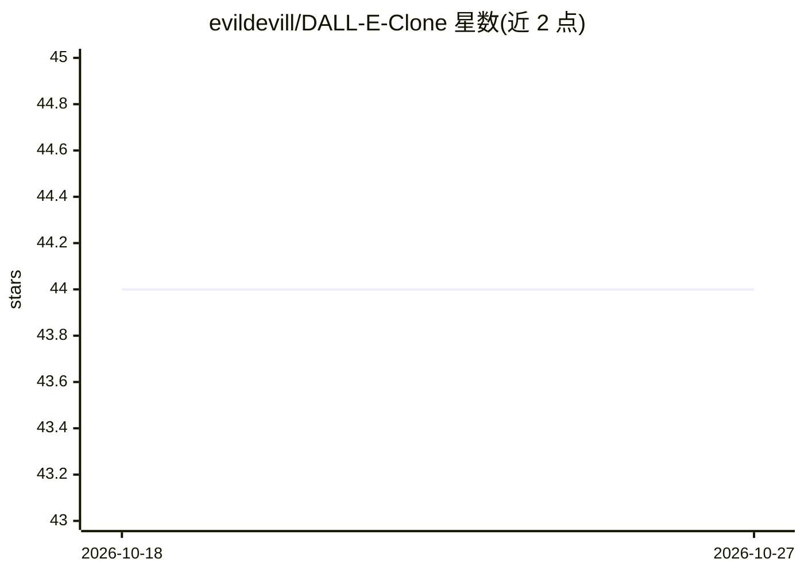

# evildevill/DALL-E-Clone

⭐ 44 · JavaScript · MIT · 推送 2026-02-12 · [GitHub](https://github.com/evildevill/DALL-E-Clone) · [官网](https://dalle.hackerwasii.com) · 个人维护

**模仿 MidJourney 与 DALL·E 的 AI 图像生成网页应用**

一个 AI 图像生成 Web 应用项目，README 自述为 MidJourney 与 DALL·E 的克隆，提供在线预览地址，属图像生成类应用。可见 README 内容极少，未提供安装命令、依赖说明或 API 配置细节，仅含项目标题、描述与在线预览链接，具体实现方式（是否调用 OpenAI DALL·E API 等）无法从可见内容验证。

## 筛选速览

| 维度 | 判定 | 备注 |
|---|---|---|
| AI 角色 | `ai-native` | 本体是模型或模型工具 |
| 许可风险 | `permissive` | MIT |
| 部署形态 | `None` |  |
| 模型依赖 | — | README 未给出锁定关系 |
| 硬件要求 | — | 无带数字的原话,不猜 |
| 安装摩擦 | `low` | 无编译、无系统依赖或容器化 |
| 成熟度 | — | 结构信号不足 |

## 能力要点

- 提供在线预览地址
- 定位为 AI 图像生成应用

## 适用场景

- 在线生成 AI 图像
- 学习图像生成应用的界面实现

## 场景标签

`图像生成` · 领域:内容生成

## 证据(README 行号)

> L2: AI Image Generation App MidJourney &amp; DALL E Clone
> L8: Image Generation App

## 星数曲线

2026-10-18 44 → 2026-10-27 44（+0）

---
*卡片 v1 · prompt 1.4 · 生成 2026-10-25 · 置信度 low · 依据 README sha `be2210c397cc` · [字段定义](../../DATASET.md)*
