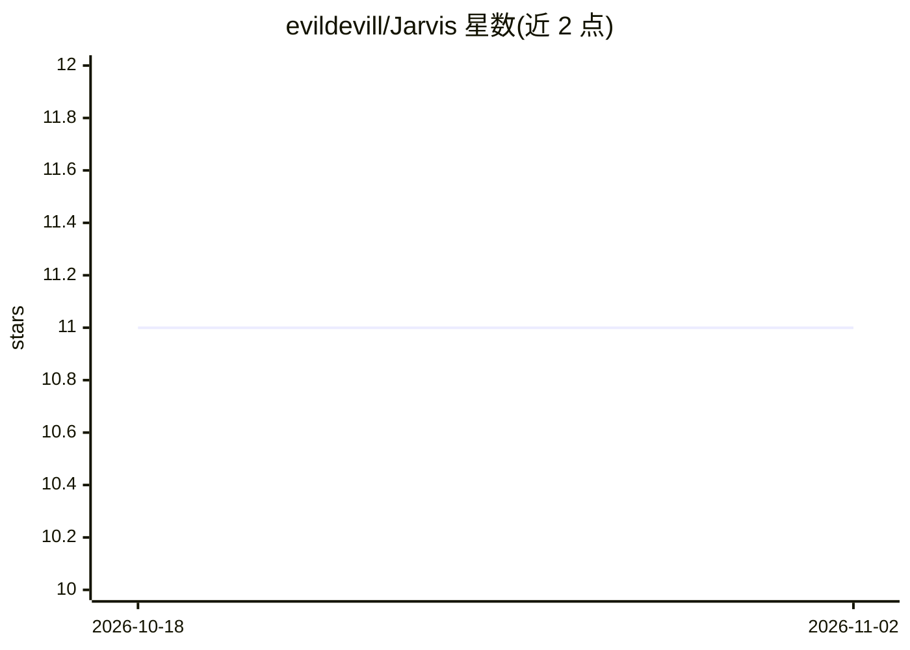

# evildevill/Jarvis

⭐ 11 · Python · MIT · 推送 2026-02-05 · [GitHub](https://github.com/evildevill/Jarvis) · [官网](https://hackerwasii.com) · 个人维护

**Python 语音助手：语音命令控制电脑与查询信息**

个人开发者用 Python 编写的桌面语音助手，模仿电影《钢铁侠》中的 JARVIS。功能以语音命令驱动：启动应用、打开网站、查天气、读日历事件、Wikipedia/WolframAlpha 问答、播放音乐、发邮件、截图、读系统状态（RAM/电池/CPU）等，带图形界面。运行需 Python 3.8.5 并自行申请 OpenWeatherMap、WolframAlpha、Google Calendar 等 API 密钥，通过 clone 源码并在 config.py 填入密钥后运行。

## 筛选速览

| 维度 | 判定 | 备注 |
|---|---|---|
| AI 角色 | `ai-native` | 本体是模型或模型工具 |
| 许可风险 | `permissive` | MIT |
| 部署形态 | `None` |  |
| 模型依赖 | — | README 未给出锁定关系 |
| 硬件要求 | — | 无带数字的原话,不猜 |
| 安装摩擦 | `low` | 无编译、无系统依赖或容器化 |
| 成熟度 | — | 结构信号不足 |

## 能力要点

- 语音命令启动应用、开网站、查天气与日历
- Wikipedia/WolframAlpha/Google 问答与搜索
- 发邮件、截图、文件隐藏/显示等桌面自动化
- 带图形用户界面

## 适用场景

- 用语音操控电脑完成日常桌面任务
- 语音查询天气、新闻、百科与数学计算
- 语音记笔记、发邮件与管理日程提醒

## 场景标签

`语音 Agent` `AI 助手` · 领域:对话与助手

## 证据(README 行号)

> L1: # JARVIS (Just a Rather Very Intelligent System)
> L3: #### This was my attempt to make a voice assistant similar to JARVIS (in iron man movie)
> L13: It can do a lot of cool things, some of them being:

## 星数曲线

2026-10-18 11 → 2026-11-02 11（+0）

---
*卡片 v1 · prompt 1.4 · 生成 2026-11-02 · 置信度 mid · 依据 README sha `6efa9c6a463e` · [字段定义](../../DATASET.md)*
