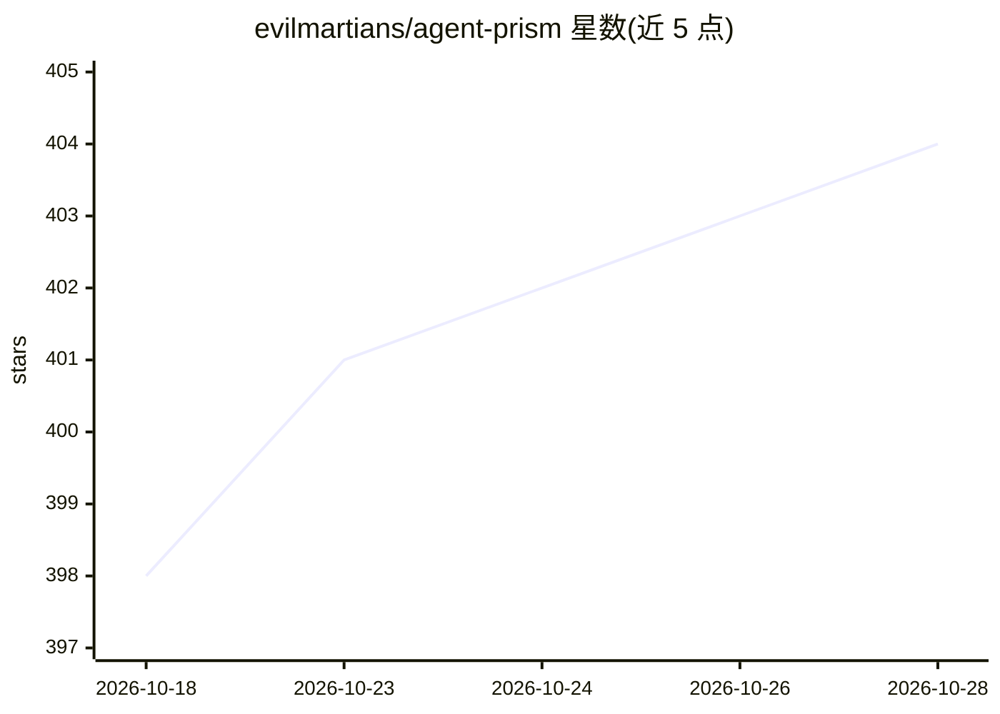

# evilmartians/agent-prism

⭐ 404 · TypeScript · MIT · 推送 2026-10-08 · [GitHub](https://github.com/evilmartians/agent-prism) · [官网](https://storybook.agent-prism.evilmartians.io/?utm_source=github&utm_medium=social) · 组织维护

**可视化 AI agent 追踪数据的 React 组件库，用于调试**

面向开发者的开源 React 组件库，将 AI agent 的调用轨迹（LLM 调用、工具执行、agent 工作流）转换为分层时间线图等可视化界面，用于调试。通过适配器读取 OpenTelemetry（OTLP）、Langfuse 等格式的追踪数据，转换为统一的 TraceSpan 结构后由组件渲染；支持 OpenTelemetry GenAI、OpenInference 等语义约定属性，并提供主题定制。要求 React 19+、Tailwind CSS 3、TypeScript；组件通过 npx degit 复制到项目中使用，需另行安装 data/types 包及若干 UI 依赖。自述为 Alpha 版本，API 可能变动。

## 筛选速览

| 维度 | 判定 | 备注 |
|---|---|---|
| AI 角色 | `ai-ecosystem` | LLM/agent 周边工具 |
| 许可风险 | `permissive` | MIT |
| 部署形态 | `library` | 以包/库形式分发 |
| 模型依赖 | — | README 未给出锁定关系 |
| 硬件要求 | — | 无带数字的原话,不猜 |
| 安装摩擦 | `low` | 无编译、无系统依赖或容器化 |
| 成熟度 | `idea` | |

## 能力要点

- TraceViewer 完整组件含追踪列表、树状 span 视图与详情面板
- 提供 OpenTelemetry(OTLP) 与 Langfuse 数据格式适配器
- 识别 OpenTelemetry GenAI、OpenInference 等语义约定属性
- 语义化主题令牌（Oklch 格式），支持 Tailwind 集成与自定义

## 适用场景

- 把 agent 追踪 JSON 转成可视化时间线来调试行为
- 在自己的开发工具面板中嵌入 LLM 调用与工具执行的观测视图
- 对接 OpenTelemetry/Langfuse 数据做可观测性展示

## 场景标签

`LLM 可观测性` · 领域:评测与运维

## 证据(README 行号)

> L3: AgentPrism is an open source library of React components for visualizing traces from AI agents. Agentic traces conta
> L5: Use AgentPrism and turn traces into clear, visual diagrams for debugging AI agents. Plug in OpenTelemetry data and s

## 星数曲线

2026-10-18 398 → 2026-10-28 404（+6）

---
*卡片 v1 · prompt 1.4 · 生成 2026-10-21 · 置信度 high · 依据 README sha `ab502560e8b6` · [字段定义](../../DATASET.md)*
