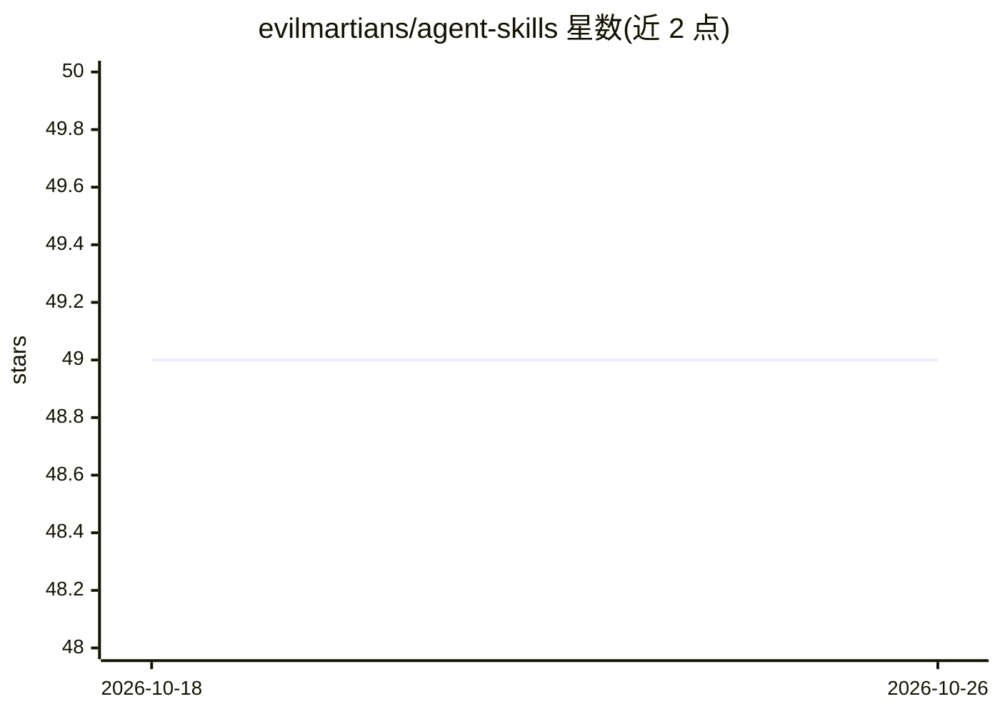

# evilmartians/agent-skills

⭐ 49 · Shell · MIT · 推送 2026-10-14 · [GitHub](https://github.com/evilmartians/agent-skills) · [官网](https://evilmartians.com/agent-skills) · 组织维护

**Evil Martians 出品的 AI 编程 agent 技能集合（6 个 SKILL.md）**

由 Evil Martians 团队构建并自用的 Agent Skills 仓库：每个技能是一个含 SKILL.md 的文件夹（名称、触发描述、执行指令），格式跨 agent 通用，可安装到 Claude Code、Codex、Cursor、Gemini CLI 与 GitHub Copilot。当前收录 6 个技能，覆盖 README 撰写、网站对 LLM 可见性、npm 安全发布流程、技能目录发布、Tailwind CSS 最佳实践与 Web 视频编码（内置 ffmpeg 脚本）。提供 npx、Claude 插件市场、gh skill 及手动复制四种安装途径；仓库自行策展不接受外部贡献，MIT 许可。

## 筛选速览

| 维度 | 判定 | 备注 |
|---|---|---|
| AI 角色 | `ai-knowledge` | 知识聚合/清单类 |
| 许可风险 | `permissive` | MIT |
| 部署形态 | `library` | 以包/库形式分发 |
| 模型依赖 | — | README 未给出锁定关系 |
| 硬件要求 | — | 无带数字的原话,不猜 |
| 安装摩擦 | `medium` | 含编译或系统依赖之一 |
| 成熟度 | — | 结构信号不足 |

## 能力要点

- 6 个技能，SKILL.md 格式跨 5 种 AI 编程 agent 通用
- 四条安装途径：npx skills / Claude 插件市场 / gh skill / 手动复制
- 技能可随附脚本与参考资料，整目录分发
- 不接受外部贡献，MIT 许可可自行 fork

## 适用场景

- 给 Claude Code / Codex 等 AI 编程 agent 安装专家级技能
- 让 agent 撰写或改进开源项目 README
- 为网站配置 LLM 可见性与 llms.txt 等机制
- 搭建安全的 npm 发布流程或编码 Web 视频

## 场景标签

 · 领域:AI 编程工具/技能分发

## 证据(README 行号)

> L3: Agent Skills we build and use at Evil Martians, packaged so you can install them into your own AI coding agent.
> L5: A skill is a folder with a `SKILL.md` in it: a name, a description that tells the agent when to reach for it, and th

## 星数曲线

2026-10-18 49 → 2026-10-26 49（+0）

---
*卡片 v1 · prompt 1.4 · 生成 2026-10-24 · 置信度 high · 依据 README sha `77bc2b9256dd` · [字段定义](../../DATASET.md)*
