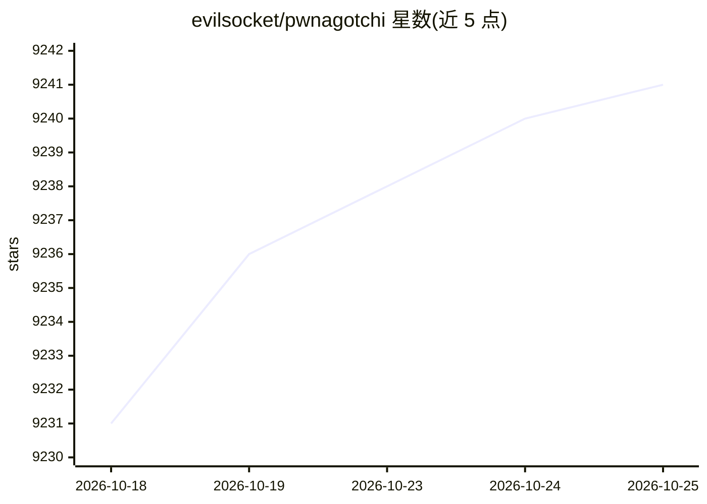

# evilsocket/pwnagotchi

⭐ 9,241 · Python · NOASSERTION · 推送 2026-08-19 · [GitHub](https://github.com/evilsocket/pwnagotchi) · [官网](https://pwnagotchi.ai/) · 个人维护

**用深度强化学习驱动 bettercap 捕获可破解 WPA 握手包的设备**

Pwnagotchi 是一个基于 A2C 的强化学习系统，策略网络为 LSTM+MLP 特征提取器，通过操控 bettercap 从周边 WiFi 环境中学习，以最大化捕获可破解的 WPA 密钥材料（PCAP 文件，含 PMKID、完整与半握手）。学习以 epoch 为单位随时间进行，初始阶段处于参数探索期；多个邻近设备可通过自建 parasite 协议相互广播并学会分工合作。面向安全研究人员与硬件 DIY 爱好者，GPL3 许可，详细文档在 pwnagotchi.ai。README 未给出安装命令，需查阅外部文档。

## 筛选速览

| 维度 | 判定 | 备注 |
|---|---|---|
| AI 角色 | `ai-native` | 本体是模型或模型工具 |
| 许可风险 | `none` | NOASSERTION |
| 部署形态 | `None` |  |
| 模型依赖 | — | README 未给出锁定关系 |
| 硬件要求 | — | 无带数字的原话,不猜 |
| 安装摩擦 | `low` | 无编译、无系统依赖或容器化 |
| 成熟度 | — | 结构信号不足 |

## 能力要点

- A2C 智能体（LSTM + MLP 特征提取器策略网络）持续在线学习
- 通过 bettercap 捕获 hashcat 支持的握手/PMKID 材料
- 多设备间基于 dot11 的 parasite 协议实现协作分工信道

## 适用场景

- 在授权测试环境中采集 WPA 握手包用于密码审计
- 观察强化学习智能体在真实 WiFi 环境中的持续学习过程
- 多台设备协作分工扫描信道

## 场景标签

`强化学习` `网络安全` · 领域:学习与行业

## 证据(README 行号)

> L8: Pwnagotchi is an A2C-based "AI" leveraging bettercap that learns from its surrounding WiFi environment to maximize t
> L15: More specifically, Pwnagotchi is using an LSTM with MLP feature extractor as its policy network for the A2C agent. 

## 星数曲线

2026-10-18 9,231 → 2026-10-25 9,241（+10）

---
*卡片 v1 · prompt 1.4 · 生成 2026-10-20 · 置信度 high · 依据 README sha `89484a6f38b7` · [字段定义](../../DATASET.md)*
