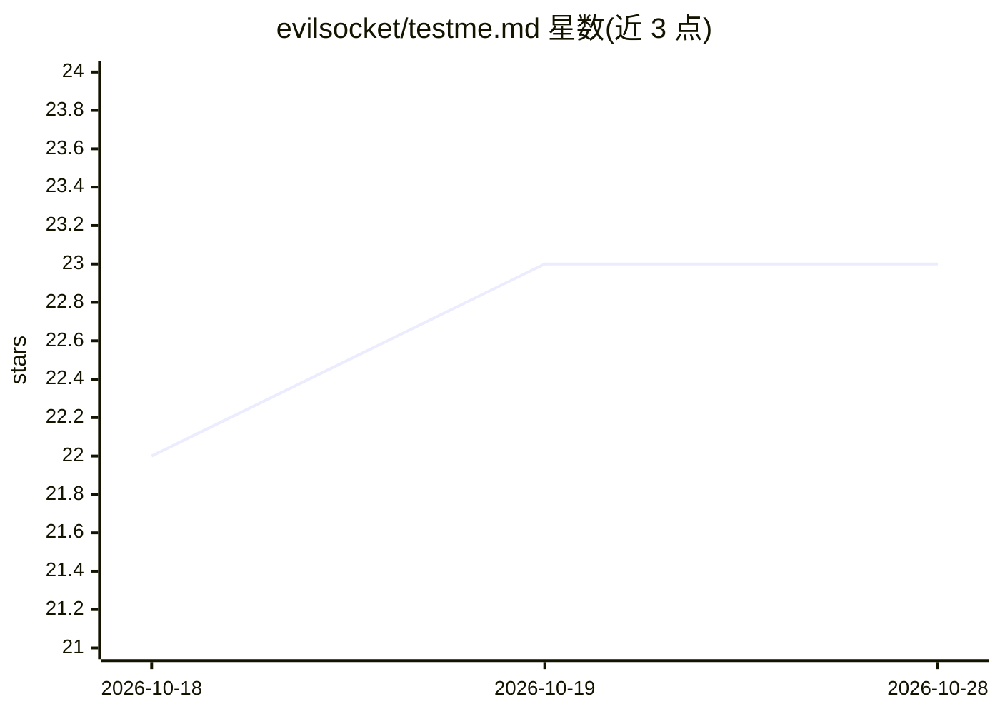

# evilsocket/testme.md

⭐ 23 · NOASSERTION · 推送 2026-01-19 · [GitHub](https://github.com/evilsocket/testme.md) · [官网](https://github.com/evilsocket/testme.md) · 个人维护

**用 Markdown 编写测试规范的约定，供 AI agent 生成与执行测试**

TESTME.md 是一种以纯 Markdown 书写测试规范的约定：用自然语言步骤与预期描述测试，代替语言特定的测试代码。仓库提供 v1.0.0a 完整规范（SPECS.md）、供 AI agent 生成测试文件的指令集（WRITE.md）与执行测试的指令集（QA.md），以及电商应用示例。通过 curl 将指令集管道传给 Cursor 等 CLI agent 或粘贴给任意具备代码库访问权限的 AI 助手即可使用，也支持手动按规范编写 TESTME.md。采用 GPL v3.0 许可，规范标注为 alpha 版本。

## 筛选速览

| 维度 | 判定 | 备注 |
|---|---|---|
| AI 角色 | `ai-ecosystem` | LLM/agent 周边工具 |
| 许可风险 | `none` | NOASSERTION |
| 部署形态 | `None` |  |
| 模型依赖 | — | README 未给出锁定关系 |
| 硬件要求 | — | 无带数字的原话,不猜 |
| 安装摩擦 | `low` | 无编译、无系统依赖或容器化 |
| 成熟度 | `idea` | |

## 能力要点

- 纯 Markdown 测试规范，无框架依赖，人机均可读写
- WRITE.md / QA.md 两套 agent 指令集分别用于生成与执行测试
- 提供电商应用的完整示例工程

## 适用场景

- 让 AI agent 为我的代码库自动生成可读的测试文件
- 让 AI agent 查找并执行项目中的 TESTME.md 测试
- 让非开发人员也能阅读和编写测试用例

## 场景标签

`代码生成` · 领域:编码与开发

## 证据(README 行号)

> L8: TESTME.md is a convention for writing test specifications in plain Markdown that both humans and AI agents can under
> L61: |WRITE.md|Agent instructions to generate TESTME.md files|
> L62: |QA.md|Agent instructions to execute TESTME.md files|

## 星数曲线

2026-10-18 22 → 2026-10-28 23（+1）

---
*卡片 v1 · prompt 1.4 · 生成 2026-10-27 · 置信度 high · 依据 README sha `2844340b6f16` · [字段定义](../../DATASET.md)*
