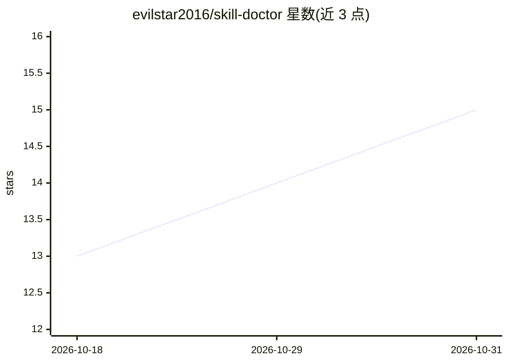

# evilstar2016/skill-doctor

⭐ 15 · TypeScript · MIT · 推送 2026-10-30 · [GitHub](https://github.com/evilstar2016/skill-doctor) · [官网](https://www.npmjs.com/package/@evilstar2025/skill-doctor) · 个人维护 · 中文 README

**本地 CLI 工具：审计 AI agent 技能的冲突、重复与上下文成本**

针对 Claude Code、Codex、Cursor 等 coding agent 平台，提供技能/规则/指令的本地健康检查：扫描已安装的 agent 配置，输出技能清单、重复安装与触发词重叠、可疑指令（shell/破坏性/凭据/网络）安全标记、以及 always-on 文件的循环 token 成本估算。默认本地检查不上传内容，可选接入用户配置的模型做分析。以 npx 方式运行无需安装，含本地 UI、CI 门禁命令与 13 个平台适配器。

## 筛选速览

| 维度 | 判定 | 备注 |
|---|---|---|
| AI 角色 | `ai-ecosystem` | LLM/agent 周边工具 |
| 许可风险 | `permissive` | MIT |
| 部署形态 | `library` | 以包/库形式分发 |
| 模型依赖 | — | README 未给出锁定关系 |
| 硬件要求 | — | 无带数字的原话,不猜 |
| 安装摩擦 | `low` | 无编译、无系统依赖或容器化 |
| 成熟度 | — | 结构信号不足 |

## 能力要点

- 扫描 13 个平台适配器下的技能、规则与指令配置
- 检测重复安装与触发词重叠
- 静态标记可疑指令（shell/凭据/网络）
- 估算循环 token 成本，支持 CI 门禁

## 适用场景

- 排查 agent 行为不一致是否由技能冲突导致
- 在引入第三方技能前做安全审查
- 估算 always-on 配置对上下文窗口的占用

## 场景标签

`提示工程` `网络安全` · 领域:Agent 开发

## 证据(README 行号)

> L11: **A local health check for AI agent skills, rules, and instructions.** Find duplicate skills, overlapping triggers,
> L37: - **Context cost:** estimate recurring token usage for skills, rules, always-on files, and supported MCP tools.

## 星数曲线

2026-10-18 13 → 2026-10-31 15（+2）

---
*卡片 v1 · prompt 1.4 · 生成 2026-10-31 · 置信度 high · 依据 README sha `d9b712bd6833` · [字段定义](../../DATASET.md)*
