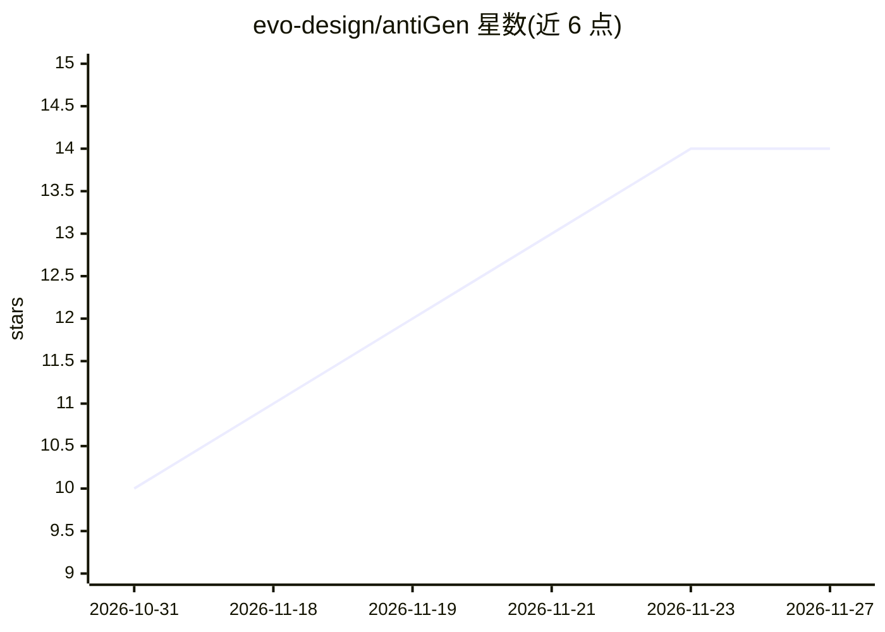

# evo-design/antiGen

⭐ 14 · Python · MIT · 推送 2026-11-25 · [GitHub](https://github.com/evo-design/antiGen) · 组织维护

**基于系统发生树预测病毒蛋白未来突变的科研模型**

antiGen 从带突变注释的系统发生树生成训练数据，训练后输出病毒蛋白氨基酸替换的概率分布，可用于排序候选突变并做时间截断式回测评估。提供 PyPI 包与多个 CLI（train/infer/eval/top-decile），内置 2023-01-01 截止日期前序列训练的 SARS-CoV-2 spike 预训练模型，CPU 数秒即可完成 RBD 打分；另含 C++/CUDA 数据生成器与 R 复现脚本。适用于病毒演化研究者，需自行准备 Nextstrain 树数据以训练自定义模型。

## 筛选速览

| 维度 | 判定 | 备注 |
|---|---|---|
| AI 角色 | `ai-native` | 本体是模型或模型工具 |
| 许可风险 | `permissive` | MIT |
| 部署形态 | `library` | 以包/库形式分发 |
| 模型依赖 | — | README 未给出锁定关系 |
| 硬件要求 | `cpu-ok` | |
| 安装摩擦 | `high` | 编译与系统依赖俱全 |
| 成熟度 | — | 结构信号不足 |

## 能力要点

- 基于系统发生树预测氨基酸替换概率，输出 top-decile 排名
- 内置 2023-01-01 截止日期前训练的 SARS-CoV-2 spike 预训练模型
- 支持 transformer、ESM-2 及 BLOSUM62/PFM 等多种模型类型
- 强制时间截断防泄漏：训练拒绝含截断后记录的文件

## 适用场景

- 用预训练模型对 SARS-CoV-2 spike 序列排序候选突变
- 基于自己的 Nextstrain 树生成数据并训练病毒蛋白演化预测模型
- 按时间截断做前瞻式回测评估
- 复现论文中的评估与图表

## 场景标签

`科研工具` · 领域:学习与行业

## 证据(README 行号)

> L3: Welcome to antiGen, a model that predicts future mutations to viral proteins based on inferred phylogenetic trees. T
> L20: pip install antigen-model            # core: from-scratch transformer + BLOSUM62 / PFM / gated (no model downloads)
> L79: generator is C++ and the figure code is R. No non-standard hardware is required. A GPU

## 星数曲线

2026-10-31 10 → 2026-11-27 14（+4）

---
*卡片 v1 · prompt 1.4 · 生成 2026-11-18 · 置信度 high · 依据 README sha `aa0f740bfe21` · [字段定义](../../DATASET.md)*
