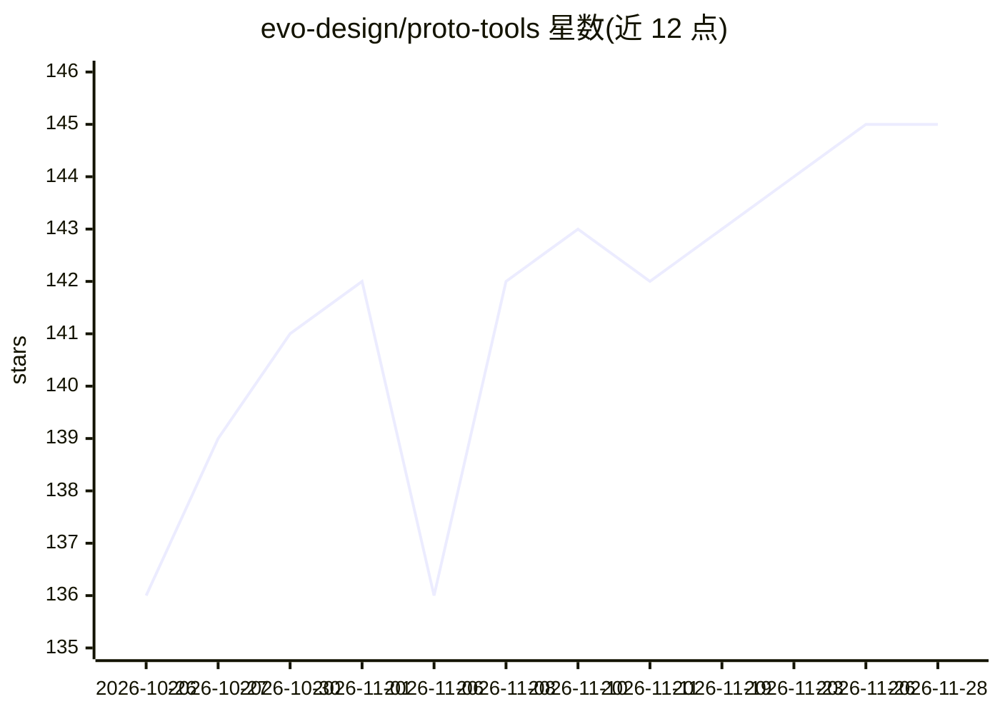

# evo-design/proto-tools

⭐ 145 · Python · MIT · 推送 2026-11-27 · [GitHub](https://github.com/evo-design/proto-tools) · [官网](https://proto.evodesign.org/docs/tools/introduction) · 组织维护

**为计算生物学与生物 AI 工具提供统一接口的 Python 基础设施层**

开源 Python 包，将语言模型、结构预测、逆折叠、序列比对、基因注释、基因组打分等上百个生物工具收拢到统一接口，通过单条 pip 命令安装。工具环境自动隔离，可共存冲突依赖；提供设备管理、GPU fan-out 并行、本地或 Modal 远程执行。可作为独立 Python 库、proto 优化系统的一部分，或经托管 MCP 服务器由 Claude/ChatGPT 等 AI 助手调用。部分工具依赖需先接受许可条款的受限模型。

## 筛选速览

| 维度 | 判定 | 备注 |
|---|---|---|
| AI 角色 | `ai-ecosystem` | LLM/agent 周边工具 |
| 许可风险 | `permissive` | MIT |
| 部署形态 | `library` | 以包/库形式分发 |
| 模型依赖 | — | README 未给出锁定关系 |
| 硬件要求 | — | 无带数字的原话,不猜 |
| 安装摩擦 | `low` | 无编译、无系统依赖或容器化 |
| 成熟度 | — | 结构信号不足 |

## 能力要点

- 覆盖 17 类工具：结构预测、逆折叠、分子对接、序列比对、基因注释等
- 工具环境隔离管理，支持冲突依赖共存
- 设备管理与 ToolPool 跨 GPU 并行执行
- 托管 MCP 服务器供 Claude/ChatGPT 等 AI 助手调用工具

## 适用场景

- 在统一的 Python 接口下运行 AlphaFold、Evo2 等多种生物模型
- 让 Claude/ChatGPT 通过 MCP 帮忙执行蛋白设计与序列分析
- 本地与远程混合算力下并行跑结构预测任务

## 场景标签

 · 领域:生命科学/计算生物学基础设施

## 证据(README 行号)

> L25: `proto-tools` is an open-source Python package that gives computational biology and biological AI tools a common in
> L27: Tool environments are isolated and managed automatically, so you can use tools with conflicting dependencies togeth
> L45: To use these tools from Claude, ChatGPT, or another AI assistant, connect our MCP server. See the MCP installation 

## 星数曲线

2026-10-26 136 → 2026-11-28 145（+9）

---
*卡片 v1 · prompt 1.4 · 生成 2026-11-28 · 置信度 mid · 依据 README sha `f9973559c84c` · [字段定义](../../DATASET.md)*
