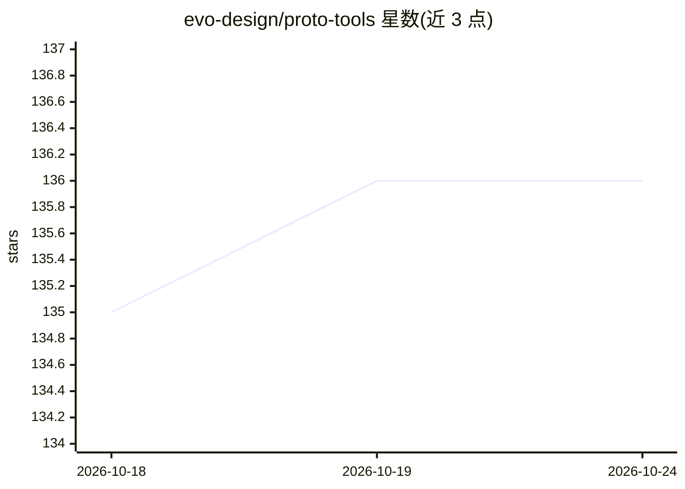

# evo-design/proto-tools

⭐ 136 · Python · MIT · 推送 2026-10-24 · [GitHub](https://github.com/evo-design/proto-tools) · [官网](https://proto.evodesign.org/docs/tools/introduction) · 组织维护

**面向生成式生物学的计算/AI 工具统一调用基础设施**

Python 包 proto-tools，将大量计算生物学与生物 AI 工具（语言模型、结构预测、逆折叠、序列分析、基因注释、对接打分等）收拢到统一接口下，经 pip 安装即用。每个工具在自动管理的隔离环境中运行，依赖自动处理；提供设备管理与 GPU 并行（ToolPool）、模型保温、PROTO_HOME/PROTO_MODEL_CACHE 存储配置，可选接入 Modal 远程容器算力，并通过托管 MCP 服务器供 Claude/ChatGPT 等 AI 助手调用。需 Python 3.10+ 与 Pydantic 2.12+；少数门控模型（ESM3、AlphaGenome 等）需先接受许可。

## 筛选速览

| 维度 | 判定 | 备注 |
|---|---|---|
| AI 角色 | `ai-ecosystem` | LLM/agent 周边工具 |
| 许可风险 | `permissive` | MIT |
| 部署形态 | `library` | 以包/库形式分发 |
| 模型依赖 | — | README 未给出锁定关系 |
| 硬件要求 | — | 无带数字的原话,不猜 |
| 安装摩擦 | `low` | 无编译、无系统依赖或容器化 |
| 成熟度 | — | 结构信号不足 |

## 能力要点

- 统一接口封装生物 AI 工具集（结构预测/逆折叠/语言模型/序列比对等）
- 每工具独立隔离环境，依赖与权重缓存自动管理
- GPU 分配、LRU 驱逐、ToolPool 多卡并行等执行基础设施
- 托管 MCP 服务器接入 Claude/ChatGPT，可选 Modal 远程执行

## 适用场景

- 在统一 Python 接口下调用多种生物学模型而不必逐个配环境
- 把生物 AI 工具接入 AI 助手，通过对话执行
- 在多 GPU 或 Modal 云端批量运行结构预测等任务

## 场景标签

 · 领域:计算生物学/AI 基础设施

## 证据(README 行号)

> L25: Welcome! This repository contains the open-source implementation of `proto-tools`, a Python package containing a la
> L27: Every tool runs in its own automatically managed isolated environment, so all dependency wrangling is handled for y
> L211: Our hosted MCP server lets Claude, ChatGPT, and other AI assistants find and run these tools for you. To set up, f

## 星数曲线

2026-10-18 135 → 2026-10-24 136（+1）

---
*卡片 v1 · prompt 1.4 · 生成 2026-10-22 · 置信度 high · 依据 README sha `4bb6544a0064` · [字段定义](../../DATASET.md)*
