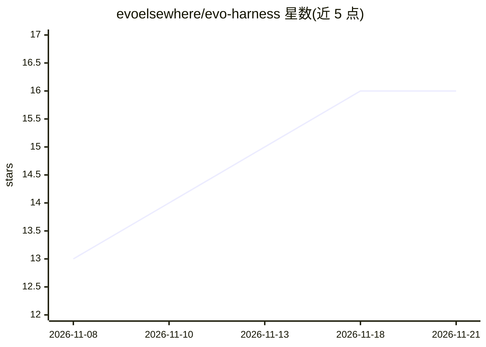

# evoelsewhere/evo-harness

⭐ 16 · Rust · Apache-2.0 · 推送 2026-11-20 · [GitHub](https://github.com/evoelsewhere/evo-harness) · [官网](https://evoelsewhere.asia) · 组织维护

**本地优先的 AI agent 桌面工作区，聚合聊天、文件、终端与浏览器**

基于 Tauri 的桌面应用，将 agent 聊天、文件与代码编辑器、终端、浏览器、Git、连接器（MCP）和技能整合到单一工作区；每个聊天由独立的 Rust headless 引擎进程运行，崩溃后可恢复。支持自带模型（hosted/cloud/local，元数据来自 models.dev）。agent 可驱动内置浏览器（1280×800 布局、按站点审批）完成导航、点击、上传等操作；Windows 上提供桌面应用控制（preview）与 Office 文档查看编辑。提供 macOS/Windows/Linux 安装包，也可用 Rust+Bun 从源码构建。

## 筛选速览

| 维度 | 判定 | 备注 |
|---|---|---|
| AI 角色 | `ai-native` | 本体是模型或模型工具 |
| 许可风险 | `permissive` | Apache-2.0 |
| 部署形态 | `None` |  |
| 模型依赖 | — | README 未给出锁定关系 |
| 硬件要求 | — | 无带数字的原话,不猜 |
| 安装摩擦 | `low` | 无编译、无系统依赖或容器化 |
| 成熟度 | — | 结构信号不足 |

## 能力要点

- 每聊天一个引擎进程，会话边跑边存、崩溃后可恢复
- BYOM：hosted/cloud/local 模型，模型元数据来自 models.dev
- agent 可驱动内置浏览器（浮动卡片、虚拟光标、按站点审批）
- 插件体系（Creator Mode）可自带页面、后端与模型，权限经同意对话框批准

## 适用场景

- 在一个桌面应用里让 AI agent 写代码、改文件、跑终端并管理 Git
- 让 agent 在浏览器里替我完成登录后才能做的网页操作
- 通过 MCP 连接器与技能按项目定制 agent 行为
- 离线/本地掌控数据地运行多个并行 agent 聊天

## 场景标签

`编码 Agent` `浏览器自动化` `GUI 自动化` · 领域:效率与自动化

## 证据(README 行号)

> L5:  Evo Harness brings agent chats, files, terminal, browser, git, connectors
> L22: - **Bring your own model** from hosted, cloud or local providers. Models,
> L99: The agent gets its own browser inside the app and works in it while you keep

## 星数曲线

2026-11-08 13 → 2026-11-21 16（+3）

---
*卡片 v1 · prompt 1.4 · 生成 2026-11-18 · 置信度 high · 依据 README sha `a767adde6bff` · [字段定义](../../DATASET.md)*
