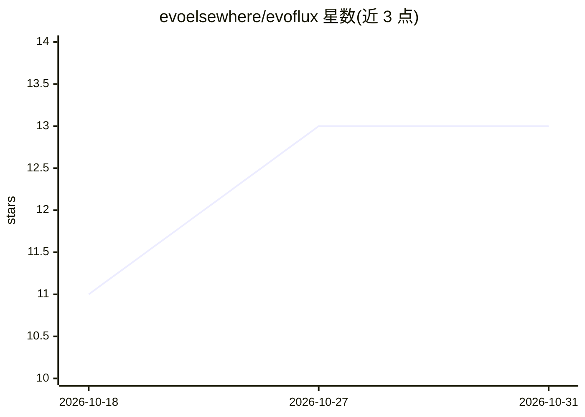

# evoelsewhere/evoflux

⭐ 13 · Python · Apache-2.0 · 推送 2026-10-30 · [GitHub](https://github.com/evoelsewhere/evoflux) · [官网](https://evoelsewhere.asia) · 组织维护

**本地优先的桌面工作区：AI agent 团队协作完成编码与研究任务**

基于 Tauri + React + FastAPI 本地 sidecar 的桌面工作区，将 agent 对话、文件、终端、浏览器、git 与验证集中于同一界面。提供 Work（通用任务）与 Coding（仓库感知开发）两种模式，支持 lead-specialist 多 agent 团队、按 agent 选择约 200 个托管/云端/本地模型供应商。含 Computer App Control（经无障碍树操控单个桌面应用窗口，需逐动作批准）、WebBridge（经中继在真实 Chrome/Edge 中工作）、本地状态、权限、沙箱与出站脱敏。macOS/Windows/Linux 提供桌面安装包，含原生 Python sidecar；也可用 uv/Bun/Rust 从源码运行。

## 筛选速览

| 维度 | 判定 | 备注 |
|---|---|---|
| AI 角色 | `ai-native` | 本体是模型或模型工具 |
| 许可风险 | `permissive` | Apache-2.0 |
| 部署形态 | `None` |  |
| 模型依赖 | — | README 未给出锁定关系 |
| 硬件要求 | — | 无带数字的原话,不猜 |
| 安装摩擦 | `low` | 无编译、无系统依赖或容器化 |
| 成熟度 | — | 结构信号不足 |

## 能力要点

- Work 与 Coding 双模式，Coding 含代码搜索、符号关系、LSP 反馈与可审查 diff
- lead-specialist 多 agent 团队，每个 agent 可配置独立模型、技能、工具与权限
- 约 200 个托管/云端/路由/本地模型供应商可选（BYOM）
- Computer App Control 与 WebBridge（策略中继下操作真实浏览器）

## 适用场景

- 在本地统一环境中让多个 agent 协作完成编码与研究任务
- 仓库感知的开发流程：代码搜索、git 工作流与 diff 审查
- 让 agent 在真实浏览器或桌面应用中执行需逐项批准的操作

## 场景标签

`多智能体` `编码 Agent` `浏览器自动化` `GUI 自动化` · 领域:Agent 开发

## 证据(README 行号)

> L3:  **A local-first desktop workspace for AI agent teams.**
> L20: - **Lead-and-specialist teams** with per-agent models, skills, tools, and
> L22: - **Bring your own model** from around 200 hosted, cloud, routed, or local

## 星数曲线

2026-10-18 11 → 2026-10-31 13（+2）

---
*卡片 v1 · prompt 1.4 · 生成 2026-10-31 · 置信度 high · 依据 README sha `f552497ada71` · [字段定义](../../DATASET.md)*
