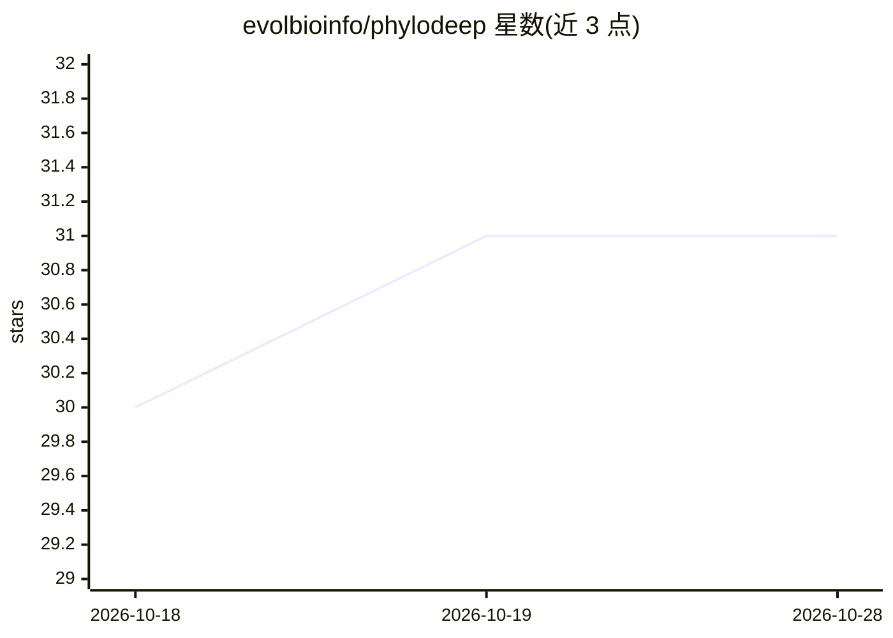

# evolbioinfo/phylodeep

⭐ 31 · Python · NOASSERTION · 推送 2026-07-21 · [GitHub](https://github.com/evolbioinfo/phylodeep) · 组织维护

**从系统发生树做参数估计与模型选择的深度学习库**

面向流行病传播动力学研究的 Python 库：读取系统发生树，用预训练深度神经网络进行先验模型充分性检验（checkdeep）、模型选择（BD/BDEI/BDSS，modeldeep）与参数预测（含 95% 置信区间），可估计 R0、传染期、超传播比例等。提供 Python API 与命令行两种使用方式，支持 pip、Docker 与 Apptainer 安装，在 Linux/Windows/macOS 测试通过，输入树会做内部重标定以覆盖较大参数空间。

## 筛选速览

| 维度 | 判定 | 备注 |
|---|---|---|
| AI 角色 | `ai-native` | 本体是模型或模型工具 |
| 许可风险 | `none` | NOASSERTION |
| 部署形态 | `self-host` | docker 或自建部署 |
| 模型依赖 | — | README 未给出锁定关系 |
| 硬件要求 | — | 无带数字的原话,不猜 |
| 安装摩擦 | `low` | 无编译、无系统依赖或容器化 |
| 成熟度 | — | 结构信号不足 |

## 能力要点

- BD/BDEI/BDSS 三种传播模型的模型选择与参数预测（含 95% CI）
- 先验模型充分性检验（checkdeep）评估输入数据与训练模拟的相似度
- 提供 Python API 与命令行两种接口
- 附带论文数据、训练用模拟器与 HIV 示例树

## 适用场景

- 从病原体系统发生树推断疫情传播动力学参数
- 在 BD/BDEI/BDSS 模型间做选择并核验模型充分性
- 复现或跟进 Nat Commun 论文中的分析流程

## 场景标签

`科研工具` · 领域:学习与行业

## 证据(README 行号)

> L3: PhyloDeep is a python library for parameter estimation and model selection from phylogenetic trees, based on deep le
> L14: __Deep learning from phylogenies to uncover the transmission dynamics of epidemics__. Nat Commun 13, 3.96 (2022)

## 星数曲线

2026-10-18 30 → 2026-10-28 31（+1）

---
*卡片 v1 · prompt 1.4 · 生成 2026-10-26 · 置信度 high · 依据 README sha `b72103af2186` · [字段定义](../../DATASET.md)*
