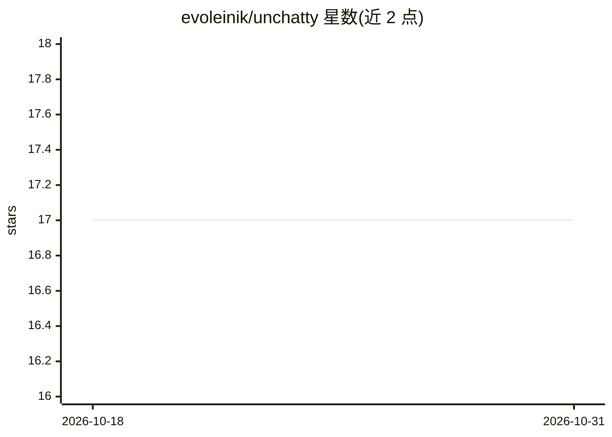

# evoleinik/unchatty

⭐ 17 · Shell · MIT · 推送 2026-08-14 · [GitHub](https://github.com/evoleinik/unchatty) · 个人维护

**压缩 Claude Code 回复长度与文风的 CLAUDE.md 规则块及 A/B 验证脚本**

面向 Claude Code 用户的提示工程工具：提供一个粘贴进 CLAUDE.md 的 COMMUNICATION.md 规则块，约束回复长度、句长、破折号与标题使用；附带 score.py 机械打分脚本与 ab-test.sh，用同一问题在规则开/关两种状态下跑 headless claude -p 会话并对比分数。作者报告长回答从 393 词降至 62 词，并说明首版规则因继承文档标点而效果相反的修正过程。限制：规则仅作用于交互式 Claude Code 会话，直接调用模型的场景不读取 CLAUDE.md。

## 筛选速览

| 维度 | 判定 | 备注 |
|---|---|---|
| AI 角色 | `ai-ecosystem` | LLM/agent 周边工具 |
| 许可风险 | `permissive` | MIT |
| 部署形态 | `None` |  |
| 模型依赖 | — | README 未给出锁定关系 |
| 硬件要求 | — | 无带数字的原话,不猜 |
| 安装摩擦 | `low` | 无编译、无系统依赖或容器化 |
| 成熟度 | — | 结构信号不足 |

## 能力要点

- COMMUNICATION.md 规则块控制回复长度、句长与破折号密度
- score.py 按词数/句长/破折号/标题机械打分
- ab-test.sh 对比规则开/关两种状态的回复并自动备份恢复 CLAUDE.md
- 作者公开首版规则的失效原因与修正（禁止继承所读文档的标点）

## 适用场景

- 让 Claude Code 回复更短、句式更平实
- 量化验证 CLAUDE.md 规则对回复风格的实际影响
- 排查 AI 回复风格是否继承了仓库文档的标点习惯

## 场景标签

`提示工程` · 领域:Agent 开发

## 证据(README 行号)

> L5: A `CLAUDE.md` block that cuts reply length and kills the dense, dash-heavy style, plus
> L18: - `COMMUNICATION.md` — paste into your `CLAUDE.md`, near the top
> L20: - `ab-test.sh` — runs the same questions with the rules on and off, then scores both

## 星数曲线

2026-10-18 17 → 2026-10-31 17（+0）

---
*卡片 v1 · prompt 1.4 · 生成 2026-10-29 · 置信度 high · 依据 README sha `3c6960393008` · [字段定义](../../DATASET.md)*
