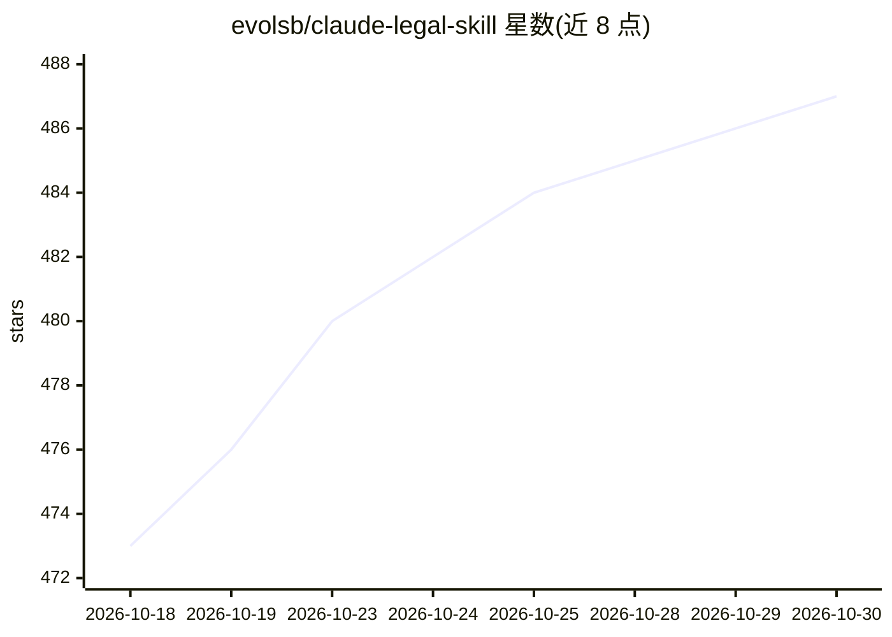

# evolsb/claude-legal-skill

⭐ 487 · MIT · 推送 2026-07-23 · [GitHub](https://github.com/evolsb/claude-legal-skill) · [官网](https://ctsheehan.com) · 个人维护

**给开发者的合同审查 Agent 技能：风险检测与红线建议**

遵循开放 Agent Skills 标准的合同审查技能，装入 Claude Code、OpenAI Codex、Cursor 等 26+ 兼容工具后在编码工作流内直接审查 NDA、SaaS/MSA、M&A 等合同。基于 CUAD 数据集（510 份真实合同的 41 类法律风险）输出分级风险评估、红旗快扫、关键条款表、市场标准基准、可协商性评级、具体红线替换语言与缺失条款建议，并支持立场感知（区分买方/卖方等）与管辖区规则。限制：非法律意见、默认美国法、超长合同需分段审查。

## 筛选速览

| 维度 | 判定 | 备注 |
|---|---|---|
| AI 角色 | `ai-native` | 本体是模型或模型工具 |
| 许可风险 | `permissive` | MIT |
| 部署形态 | `library` | 以包/库形式分发 |
| 模型依赖 | — | README 未给出锁定关系 |
| 硬件要求 | — | 无带数字的原话,不猜 |
| 安装摩擦 | `low` | 无编译、无系统依赖或容器化 |
| 成熟度 | — | 结构信号不足 |

## 能力要点

- 基于 CUAD 数据集（41 类风险）的分级风险评估与红旗快扫
- 立场感知：按用户方（买方/卖方/接收方等）调整风险判定
- 按合同类型（NDA/SaaS/支付/M&A/介绍人）提供专项检查清单
- 输出具体红线替换语言，可配合 legal-redline-tools 生成修订版文档

## 适用场景

- 在 Claude Code 等编码助手中直接审查 NDA、SaaS 等合同
- 交易前快速扫描合同红旗条款与缺失条款
- 为律师准备带具体替换措辞的初审材料

## 场景标签

 · 领域:法律科技/AI 工具

## 证据(README 行号)

> L3: > AI-powered contract review with CUAD risk detection, market benchmarks, and lawyer-ready redlines
> L40: Nothing worked as a drop-in skill. So I built one grounded in the CUAD dataset (41 legal risk categories from 510 r
> L120: This skill follows the open Agent Skills standard and works with any compatible tool.

## 星数曲线

2026-10-18 473 → 2026-10-30 487（+14）

---
*卡片 v1 · prompt 1.4 · 生成 2026-10-23 · 置信度 mid · 依据 README sha `8b4f29b8a242` · [字段定义](../../DATASET.md)*
