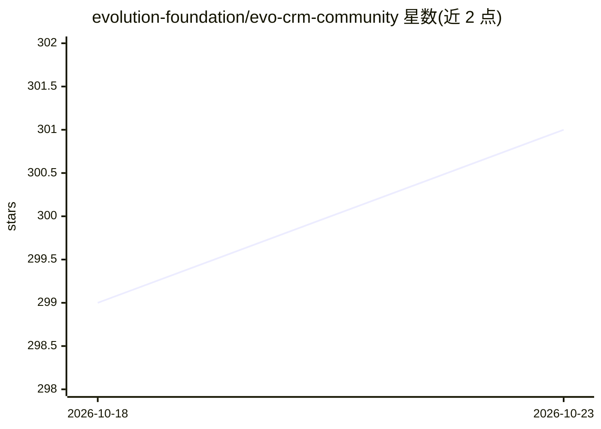

# evolution-foundation/evo-crm-community

⭐ 301 · HTML · NOASSERTION · 推送 2026-10-22 · [GitHub](https://github.com/evolution-foundation/evo-crm-community) · [官网](https://evolutionfoundation.com.br) · 组织维护

**自托管单租户 AI 客服 CRM 平台（Evo CRM 开源版）**

Evo CRM 的开源社区版（v1.0.0-rc2），以 monorepo + Git submodules 聚合 6 个服务：Rails 认证服务（RBAC/OAuth 2.0）、Rails CRM（会话/联系人/收件箱）、React 前端、Python/FastAPI 的 AI agent 执行器（含 MCP、工具、会话）、Go 的 agent 管理服务与 bot pipeline 运行时。单租户、无计费限制，配置经种子数据与环境变量，生产需覆盖 BACKEND_URL/FRONTEND_URL。另有独立版本的三项伴随项目（WhatsApp 消息引擎 evolution-api/evolution-go、多 agent 层 evo-nexus）。需 Docker Compose 部署，各服务单独配置。

## 筛选速览

| 维度 | 判定 | 备注 |
|---|---|---|
| AI 角色 | `ai-native` | 本体是模型或模型工具 |
| 许可风险 | `permissive` | NOASSERTION |
| 部署形态 | `self-host` | docker 或自建部署 |
| 模型依赖 | — | README 未给出锁定关系 |
| 硬件要求 | — | 无带数字的原话,不猜 |
| 安装摩擦 | `low` | 无编译、无系统依赖或容器化 |
| 成熟度 | `idea` | |

## 能力要点

- 6 服务组成：认证/CRM/前端/AI agent 执行（MCP、工具）/agent 管理/bot pipeline
- 单租户、无计费与功能限制，全栈自托管
- 三种子角色（agent/account_owner/super_admin）+ 运行时自定义角色
- Apache 2.0 附加品牌保护条款（LOGO/版权保留与使用通知要求）

## 适用场景

- 在企业自有服务器上运行完整的 AI 客服与 CRM 系统
- 通过 WhatsApp 等渠道（evolution-api/evolution-go）开展客服与营销活动
- 以 bot pipeline 与 AI agent 自动化处理会话

## 场景标签

`聊天机器人` · 领域:对话与助手

## 证据(README 行号)

> L7:  Open-source, single-tenant AI-powered customer support platform — by Evolution Foundation.
> L21: **Evo CRM Community** is the open-source edition of the Evo CRM platform — a complete suite for AI-assisted custome
> L68: |`evo-ai-processor-community`|AI agent execution, sessions, tools, MCP|Python 3.10 / FastAPI|`8000`|

## 星数曲线

2026-10-18 299 → 2026-10-23 301（+2）

---
*卡片 v1 · prompt 1.4 · 生成 2026-10-21 · 置信度 high · 依据 README sha `8b7b77857b33` · [字段定义](../../DATASET.md)*
